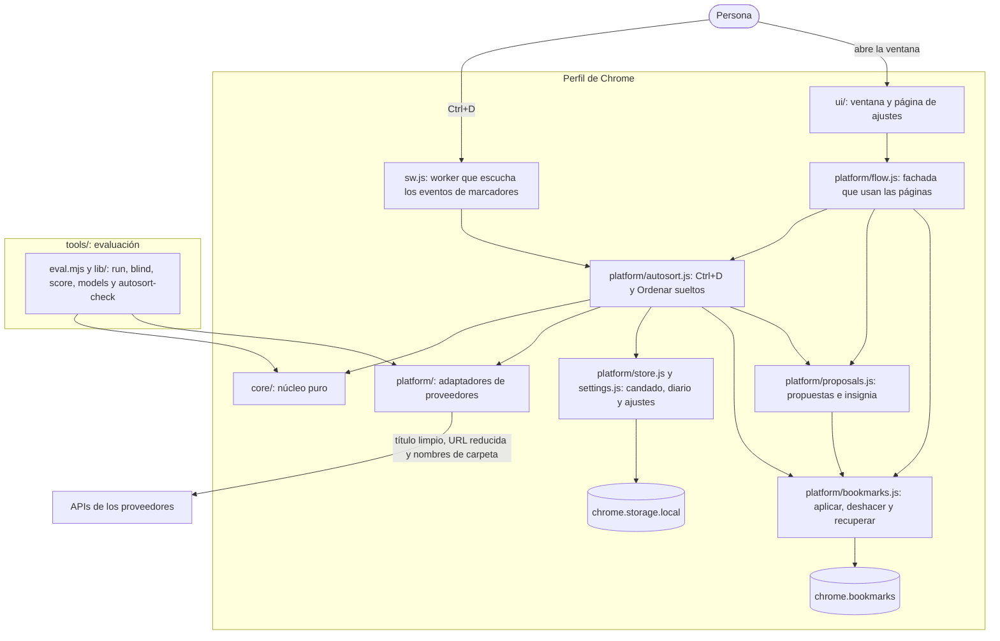

# Arquitectura de alto nivel

## Componentes actuales

El repositorio tiene dos productos que comparten el núcleo: la **extensión 0.5.1**, que corre dentro de Chrome, y la **herramienta de evaluación** (`tools/`), un comando de Node que mide modelos sobre una exportación y no toca Chrome. Las flechas muestran quién usa a quién y qué datos pasan. Son relaciones que existen a la vez, no decisiones ni pasos. Los caminos y las decisiones están en [Funcionalidades](funcionalidades.md#flujos-de-la-extensión).

### Explicación

La extensión no tiene servidor ni proceso externo: vive mientras Chrome está abierto. Tiene tres tipos de pieza:

- **El worker (`sw.js`)** se despierta con los eventos de `chrome.bookmarks`. Ctrl+D lo activa, espera unos 8 s, llama al proveedor y termina. Chrome lo detiene tras 30 s de inactividad, por eso nada de lo que hace dura más de 20 s y no guarda estado en variables.
- **Las páginas** (la ventana del ícono y la página de ajustes) pasan siempre por `platform/flow.js`, una fachada que se ejecuta en la propia página: arma los datos que la interfaz muestra y expone las acciones. Casi todo corre ahí, incluidos «Reintentar» y «Probar la clave». La excepción es «Ordenar sueltos», que dura más: la página manda un mensaje al worker y espera, para que cerrar la ventana no lo corte.
- **El estado** está en `chrome.storage.local`. No hay base de datos ni IndexedDB. El worker y las páginas lo escriben a la vez, y lo que se lee y se vuelve a escribir va detrás de un candado compartido ([El candado](#el-candado)).

Dos fronteras importan:

- **Frontera de privacidad:** la URL original se reduce y el título se limpia antes de armar la petición, igual que en la herramienta de evaluación. Los adaptadores nunca reciben la URL original. Qué sale y cuándo: [Qué sale a la nube](#qué-sale-a-la-nube).
- **Frontera de confianza:** la respuesta del modelo es entrada no confiable. En Ctrl+D devuelve un tipo (`existing`, `new`, `none`), un número de carpeta, una confianza y, si propone una carpeta, un nombre y una descripción de texto libre. El nombre se limpia y se limita a 40 caracteres, y la persona lo puede editar antes de aceptar. **Nada se crea ni se mueve por la respuesta del modelo sin que la persona lo confirme**, salvo en modo automático, y solo cuando la IA dice `existing` con confianza alta.

### El candado

Worker y páginas escriben en las mismas claves de `chrome.storage.local`, y esa API no tiene transacciones. Con dos escritores, cada uno lee, modifica y escribe, y el último pisa al primero: se perdieron cambios en 124 de 200 corridas con dos escritores ([D4](decisiones.md#d1-a-d15)). Por eso cada lectura-modificación-escritura toma un candado exclusivo de `navigator.locks`, con un nombre por área: `journal`, `settings`, `proposals`, `usage`, `log` y `metrics`. Los candados no son reentrantes. Donde `navigator.locks` no existe (Node, en las pruebas), una cola por nombre hace lo mismo dentro del proceso.

### El diario por cambio

Cada vez que la extensión mueve marcadores (un Ctrl+D automático, una propuesta aceptada, «Elegir carpeta»), eso es **un cambio** con su propio registro:

1. Antes del primer movimiento se escribe la **intención**: qué se va a mover y el orden de las carpetas de origen.
2. Se mueve un nodo a la vez, y cada 25 movimientos se escriben en el diario, agrupados en tramos de hasta 200.
3. Al terminar se cierra el cambio.

Si el worker muere a medias, el cambio queda `running`; al arrancar, `recoverInterrupted` lee el árbol real y concilia lo que sí se movió. **Deshacer** es por id de cambio: devuelve cada nodo tras su antecesor vivo más cercano y borra la carpeta que el cambio creó si quedó vacía. Un nodo que la persona movió después se deja donde está y se informa. El diario guarda los 20 últimos cambios; uno más viejo ya no se puede deshacer.

### Cómo comparte el núcleo con `tools/`

La herramienta de evaluación importa `extension/core/` y los adaptadores de `extension/platform/`; no tiene copias. Así M0 midió el mismo núcleo que corre en la extensión.

| Pieza | Evaluación (`tools/`) | Extensión |
|---|---|---|
| `core/url.js`, `prompt.js`, `taxonomy.js`, `classify.js`, `batching.js`, `budget.js`, `models.js` | Los usa `run` | Los usa «Ordenar sueltos» (carpetas, clasificación, lotes de 50, tope) y Ctrl+D (saneamiento, tope) |
| `core/autosort.js` | Lo importa `autosort-check`, que mide **el prompt real** de Ctrl+D con el mismo armado de contexto | Lo usa Ctrl+D |
| `platform/llm.js`, `openai-compatible.js`, `providers.js`, `complete-factory.js` | Siete proveedores | Seis proveedores (`fetch`). El de Anthropic existe en el código pero no se cablea: sin SDK empaquetado, la extensión lo muestra como «próximamente» |
| Reintentos y espera | Del corredor: hasta 5 intentos, esperas de `retry-after` | Propios del worker: un solo reintento ante 5xx, 408 o 409, dentro de un plazo de 20 s. Un 429 no se reintenta |
| Tope de gasto | Compartido por la corrida (`--max-usd`) | Diario: 50 llamadas (editable) y US$0,10 a tarifa de pago |
| Estado | Archivos en `--out` | `chrome.storage.local` |

El armado del contexto de Ctrl+D (exclusiones, duplicado, saneamiento, carpetas, sueltos) vive hoy en `platform/autosort.js`, y `autosort-check` repite esa secuencia en vez de importarla. Si alguien cambia una, debe cambiar la otra: la prueba de `autosort-check` compara el `system` y el esquema enviados con los de la extensión, pero el orden de la secuencia es una copia hecha a mano.

## Decisiones de arquitectura

El razonamiento completo y el costo de revertir cada una están en [Decisiones](decisiones.md).

| Decisión | Motivo | Costo |
|---|---|---|
| Extensión sobre `chrome.bookmarks`, no editar el archivo `Bookmarks` | Permite reaccionar a Ctrl+D; Chromium reparte los datos en varios archivos y lo editado puede sobrescribirse | Requiere Chrome abierto |
| Medir antes de construir (M0) | La calidad es el mayor riesgo, y medirla es barato | La extensión esperó al resultado de M0 |
| Núcleo puro con puerto `complete()` | Se prueba en Node sin navegador y permite cambiar de proveedor | Un adaptador por forma de cable |
| Estado en `chrome.storage.local`, no en IndexedDB | Una sola API para claves, ajustes, propuestas y diario; con `unlimitedStorage` no hay tope práctico. El diario guarda cada movimiento una vez, en tramos | Sin transacciones: se suple con el candado. Se borra al quitar la extensión (por eso «Respaldar ahora» descarga archivos) |
| Candado `navigator.locks` por área de escritura | El worker y las páginas escriben a la vez, y se perdieron cambios en 124 de 200 corridas ([D4](decisiones.md#d1-a-d15)) | Que Web Locks se comparta entre worker y páginas no se verificó en Chrome con ventana |
| Diario por cambio, con la intención escrita antes de mover | Un worker que muere a medias deja un cambio que se concilia con el árbol real, y Deshacer es por cambio | Los 20 últimos cambios; uno más viejo no se deshace |
| «Confirmar antes de mover» por defecto | La precisión de Ctrl+D no se midió antes de construirlo; la sugerencia de pasar a automático sale de lo que la persona acepta | Un clic más por marcador |
| Ctrl+D apagado, y solo sobre lo guardado en una raíz | Respeta la elección de carpeta y evita enviar sin que la persona lo haya pedido | Un marcador guardado en una subcarpeta no se ordena solo |
| Copia privada de la extensión en la cuenta que usa Chrome | El directorio del proyecto lo pueden escribir otras cuentas, y Chrome ejecuta lo que ve en la carpeta | Un `rsync` por cada versión |
| Proveedores intercambiables, con `--models` obligatorio y id exacto | Fue un requisito del proyecto; la privacidad es el criterio principal y lo medido debe ser un modelo exacto | La matriz caduca y solo Gemini 3.5 Flash-Lite se probó con una corrida real. Ver [Proveedores](proveedores.md) |
| Consentimiento explícito donde el proveedor entrena o puede entrenar | La cuenta puede estar en un plan que entrena, y ninguna API lo informa | Un parámetro más por proveedor |
| Saneamiento agresivo de URL y de títulos | Una fuga de token es irreversible y perder contexto cuesta poco | Algo de calidad, sin medir aún |
| Clasificación con respuesta acotada a números y confianza | Al clasificar, el modelo no puede corromper URL ni títulos | Hay que validar localmente. La propuesta de carpetas sí devuelve texto libre |
| Nombres de carpeta fuera del esquema | El esquema se cachea hasta 24 h aparte del contenido | El esquema no acota `f` |
| Reintentos en nuestra cola, no en el SDK | El SDK obedece `retry-after` sin tope | Código propio de espera |
| Tope de gasto al peor caso, con guardia de `max_tokens` | El tope solo es un techo si el proveedor respeta `max_tokens` | Totales pesimistas (`lost_usd`); un exceso cuesta a lo sumo una llamada |
| Respaldo del servidor apagado (`--fallback`) | M0 mide un modelo; el respaldo mezcla otro y lleva datos a un modelo que no elegiste | Una negativa queda como `refusal`, visible |
| Escritura incremental y manifiesto | La respuesta de un modelo no se reproduce; lo escrito es la única evidencia | Sin reanudación en M0 |
| Juicio ciego con filas repetidas y regla de decisión explícita | Quita el sesgo de ver qué modelo propuso qué y mide si tu criterio es estable | Más trabajo que mirar un porcentaje |
| Sin caché de prompts ni Batch API | Ahorran centavos a cambio de complejidad | Costo algo mayor |

## Qué sale a la nube

Es lo que la extensión o una corrida real de la herramienta envían al proveedor que elijas. Qué hace cada proveedor con ello (entrenamiento, retención, región) está en [Proveedores](proveedores.md#matriz-de-datos).

| Dato | ¿Sale? | Nota |
|---|---|---|
| Título | Sí, limpio | Sin caracteres de control ni invisibles; correos, URL y tokens se enmascaran (`[email]`, `[url]`, `[id]`); se corta a 150 caracteres. Un título que es solo una URL sale vacío. **Los nombres de personas, la salud, las finanzas, los clientes y el contexto de trabajo salen tal cual** |
| Dominio y subdominios legibles | Sí | Revela qué sitios guardas. En servicios con inquilino (por ejemplo, `slack.com`, `okta.com`, `sharepoint.com`) sale solo el servicio, sin la empresa |
| Segmentos legibles de la ruta | Sí, hasta 4 | Un nombre en una ruta legible puede salir. La ruta se corta tras segmentos como `reset`, `verify`, `invite` o `share` |
| Nombres de carpetas existentes | Sí | Evaluación: hasta 60, en la propuesta de carpetas, y pueden volver a salir en cada lote si el modelo los reutiliza. Extensión: hasta 100, de cualquier profundidad y con su ruta completa (hasta 100 caracteres), en cada llamada; las que no caben se cuentan y la fila de actividad avisa. En ambas se omite el nombre que el enmascarado alteraría |
| Query, fragmento, credenciales y puerto | No | Se eliminan siempre |
| Segmentos con aspecto de identificador | No | Heurística; ver los límites abajo |
| IP literal, `localhost`, `.local`, `.internal`, `.corp`, `.lan`, `.ts.net`, `.onion`, `vpn.*` y similares | No | El marcador completo queda excluido |
| `file:`, `chrome:`, `javascript:`, `data:`, `ftp:` | No | El marcador completo queda excluido |
| Marcadores en carpetas que coinciden con `--exclude-folder`, o en una carpeta excluida en los ajustes de la extensión | No | La única defensa contra lo que ningún patrón detecta. En la extensión no sale ni el nombre de la carpeta |
| Títulos de ejemplo y marcadores sueltos (solo extensión) | Sí, limpios | Ver abajo |
| La clave | Solo al proveedor | Va en la cabecera de la petición a su host. No se escribe en el registro ni en «Ver qué se envió»; el texto de un error se enmascara |

### Qué envía la extensión y cuándo

La extensión envía algo solo en cuatro casos. Todo lo demás (respaldar, deshacer, aceptar o descartar una propuesta, abrir la ventana) es local.

| Disparo | Cuándo | Qué sale | Llamadas |
|---|---|---|---|
| **Ctrl+D** | Unos 8 s después de guardar la página activa directamente en la barra, en Otros o en Celular, con el orden activado, y si la URL es pública, no está ya guardada y no está en una carpeta excluida | El título limpio y la URL reducida del marcador; las rutas de hasta 100 carpetas, de cualquier profundidad; hasta 5 títulos de ejemplo por carpeta; hasta 30 títulos y URL reducidas de los sueltos que están junto al nuevo. Con «Contexto: solo el marcador», sin ejemplos ni sueltos | 1. Una segunda solo si el proveedor falla con 5xx, 408 o 409 y queda tiempo |
| **Reintentar** («Clasificar de nuevo») | Al pulsarlo en una fila de la actividad | Lo mismo que Ctrl+D, sin esperar y también desde una subcarpeta | 1 o 2 |
| **Probar la clave** | Al pulsarlo | Un marcador de prueba fijo, sin carpetas ni sueltos: nada tuyo | 1 |
| **Ordenar sueltos** | Al pulsar «Enviar N y proponer», tras leer la confirmación | Títulos limpios y URL reducidas de los sueltos de la carpeta elegida (hasta 150 para proponer carpetas, todos en lotes de 50 para clasificar), los nombres de tus carpetas y las descripciones que el propio modelo propuso. Sin ejemplos | 1 de carpetas más 1 por lote de 50, y reintentos de faltantes |

Qué no sale nunca: hosts privados, esquemas que no son web, query y fragmento, carpetas excluidas (ni el nombre ni su contenido), la URL completa y la clave. Esto vale también para los ejemplos y los sueltos: un host privado no sale ni como ejemplo ni como suelto.

Antes de enviar, la extensión exige: el permiso del host del proveedor, una clave guardada y, donde el proveedor entrena con lo que recibe o puede hacerlo (Gemini, Mistral, DeepSeek), el consentimiento v3 vigente. «Ver qué se envió», en los ajustes, lista lo último que salió: el marcador, cada carpeta con sus ejemplos y los sueltos, con título y host.

### Límites del saneamiento

El saneamiento es heurístico y opta por descartar cuando hay duda, pero **no es una garantía**. En el corpus reservado de pruebas (escrito antes de las reglas, sintético), todavía pasan **8 de 34 secretos** dentro de títulos o URL; los hosts privados enviados son 0 de 23 y las páginas inocuas sin su tema, 0 de 45. Las cifras no predicen cuántos secretos hay en una colección real.

Lo que la forma de una URL no resuelve, y por tanto sigue pasando:

- Valores de menos de 8 caracteres (`/invite/kX9mQ2` se parece a `/docs/react19`); se detienen solo tras un segmento marcador o en un host de la lista.
- Palabras usadas como secreto (`/quiet-lake-sings`, `correct-horse-battery-staple`) y letras al azar que se leen como una palabra, más cuanto más cortas.
- Trozos aleatorios de 3 caracteres o menos.
- Nombres de personas y empresas en una ruta legible, y nombres de documentos.
- Dominios privados bajo un dominio público sin una etiqueta reveladora, como `jenkins.prod.acme.cloud`.
- `PUBLIC_SECOND_LEVEL_LABELS` es una aproximación corta de la lista de sufijos públicos: `me.uk`, por ejemplo, se trata como un dominio común.

En los **títulos**, medido sobre 56 títulos sensibles y 50 inocuos sintéticos (el alcance de los patrones, no la prevalencia): se enmascaran los correos (8 de 8), las URL (5 de 5) y un secreto explícito (2 de 3); pasan casi todos los de trabajo interno (1 de 11 enmascarado), viajes y pedidos (1 de 4), finanzas (0 de 8), teléfono (0 de 2), persona (0 de 10) y salud (0 de 5). El efecto de los títulos enmascarados y las rutas recortadas en la calidad de clasificación no se ha medido.

### Qué hacer

- **Revisa `payload-preview.jsonl` y `existing-folders.json`** antes de la corrida real: es exactamente lo que saldría, con la salvedad de que la petición agrega el prompt y la lista de carpetas.
- **Excluye lo sensible** con `--exclude-folder`, repetible, antes de gastar.
- **Haz la corrida real sobre una copia privada de la exportación y con un `--out` privado**: un directorio con modo 700 de tu cuenta, fuera del árbol compartido. Lo que se escribe (`payload-preview.jsonl`, CSV, `assignments-*.jsonl`) contiene tus títulos. Si además corres desde una copia privada del proyecto, se cierra el riesgo de que otra cuenta reemplace `tools/` y ejecute su código con tu clave ([SEG-4](decisiones.md#escritura-de-archivos)).
- **No compartas `eval-out/` sin revisarla.**
- **En la extensión,** excluye las carpetas sensibles en los ajustes, usa «Contexto: solo el marcador y los nombres de tus carpetas» si no quieres enviar títulos ajenos al marcador, y lee «Ver qué se envió» después de la primera llamada.

### Retención en Anthropic

Vale para la herramienta de evaluación. La extensión todavía no tiene el adaptador de Anthropic.

Anthropic no entrena con los datos de la API por defecto y los borra a los 30 días, según el centro de privacidad; la documentación de la API dice que no se retienen por defecto (las dos fuentes no coinciden, así que se asume lo peor). Pero:

- El contenido marcado por el clasificador de seguridad puede guardarse **hasta 2 años**, y los puntajes de clasificación de seguridad, **hasta 7 años** ([retención comercial](https://privacy.claude.com/en/articles/7996866-how-long-do-you-store-my-organization-s-data), [API y retención de datos](https://platform.claude.com/docs/en/manage-claude/api-and-data-retention)).
- **Riesgo inferido, no documentado:** si una negativa del clasificador cuenta como contenido marcado, un solo título (propio o puesto por un tercero) puede dejar a sus vecinos de lote en la retención larga, y la bisección repite el envío. Medido contra el servidor falso, un título rechazado en un lote de 50 generó 13 llamadas y 7 peticiones rechazadas con 92 títulos ajenos. No se sabe si toda negativa cuenta como marcado. Es más probable en colecciones con marcadores de ML, seguridad o biología.
- La retención cero exige aprobación de ventas, y los modelos cubiertos (Fable) exigen 30 días.

## Modelos y costo

Los precios, los ids exactos, la fecha de lectura y la fuente de cada modelo están en [Proveedores](proveedores.md#matriz-de-modelos) y no se copian aquí para que no caduquen en dos lugares. El estimado de `--dry-run` no incluye razonamiento; el costo real sale de `report.md`.

## Stack

| Pieza | Versión | Origen |
|---|---|---|
| Node (herramientas y pruebas) | 26.13.0 | Paquete `node-linux-x64` local, fijado en [package.json](../package.json); `engines` exige 20.12 o superior |
| `@anthropic-ai/sdk` | 1.5.0 | Fijado en [package.json](../package.json); solo para Anthropic |
| TypeScript | 5.9.3 | Solo para `npm run typecheck`, sobre JSDoc |
| Módulos | ESM con JSDoc, sin compilación | [package.json](../package.json) |
| Pruebas | `node:test` | Incluido en Node |
| Chrome (extensión) | 134 o superior; probada en 156.0.8078.79 | `minimum_chrome_version` del [manifest](../extension/manifest.json), por `syncing` |
| Manifest | V3, versión 0.5.1 | Permisos fijos: `bookmarks`, `storage`, `unlimitedStorage`. Opcionales: `tabs` y los hosts de 6 proveedores |
