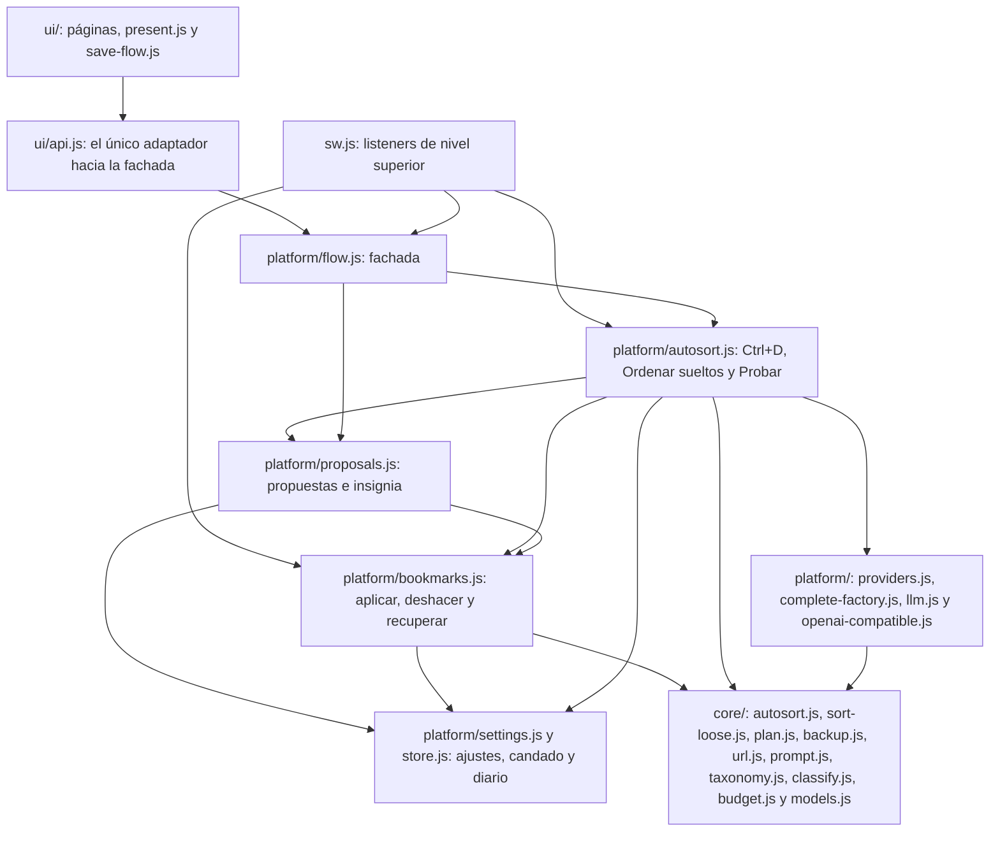
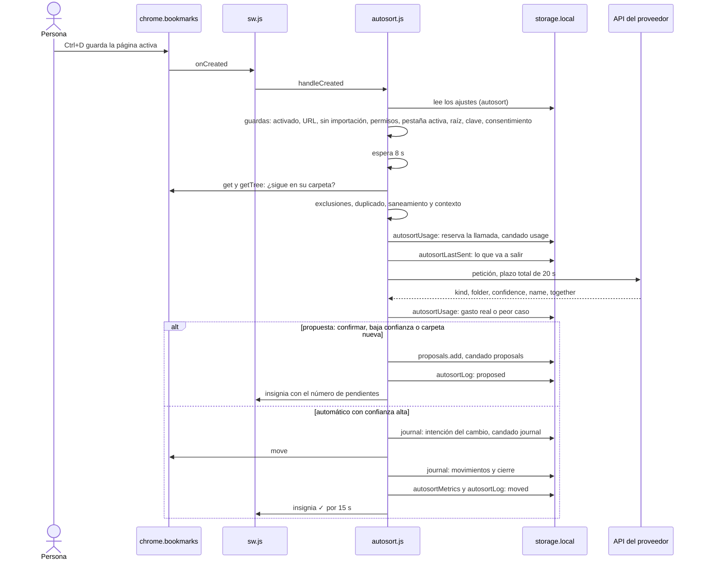
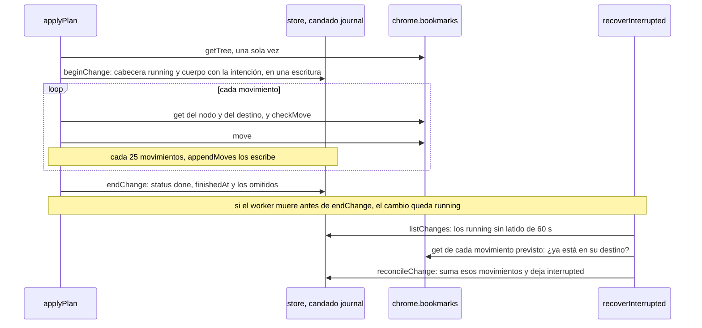
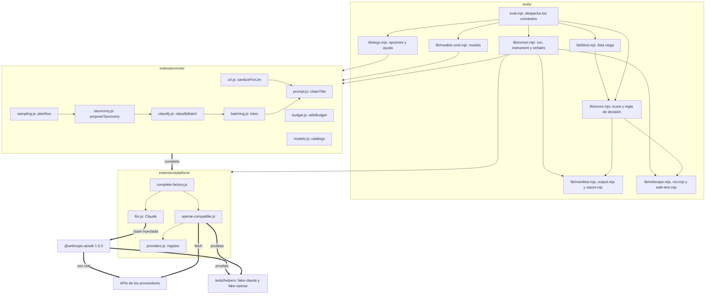
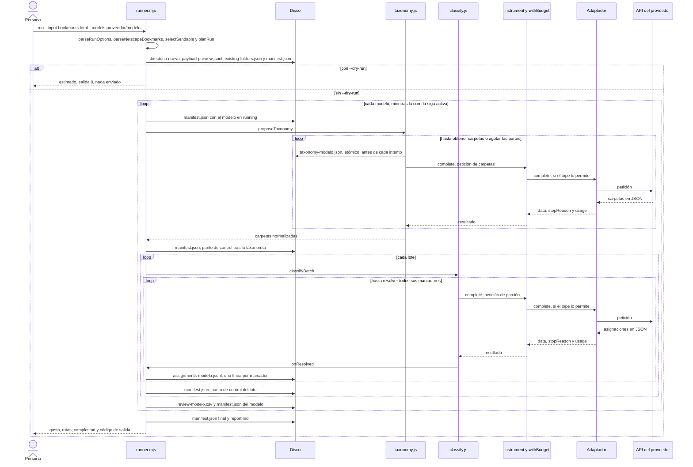

# Arquitectura de bajo nivel

## Módulos de la extensión

Las flechas son dependencias de código (`import`). Las cajas agrupadas resumen varios archivos. Para no saturarlo, el diagrama agrupa `settings.js` y `store.js` en una caja y omite las flechas de `flow.js` hacia `bookmarks.js`, `settings.js`, `providers.js` y `core/`, las de `proposals.js` y `settings.js` hacia `core/`, las de las páginas hacia la plataforma y el núcleo, y las internas de `core/`; la tabla lista cada importación. Son relaciones, no decisiones del programa.

Tres reglas del diseño que el diagrama no muestra:

- **`core/` no importa `chrome.*` ni APIs de Node.** Todo lo que toca el navegador está en `platform/` y `ui/`, y recibe la API como parámetro (`bookmarks`, `storage`, `tabs`, `permissions`, `action`), para que las pruebas le pasen el falso de `tests/helpers/fake-chrome.mjs`.
- **Solo `ui/api.js` conoce a la fachada.** Si cambia un nombre en `flow.js`, se toca ese archivo. `present.js` y `save-flow.js` no importan nada: son funciones puras, y por eso tienen pruebas.
- **Ningún `innerHTML`.** Los datos de terceros (títulos, nombres de carpeta, texto del proveedor) llegan al DOM con `textContent` y nodos creados; una prueba falla si aparece una escritura de HTML desde cadenas.

| Módulo | Hace | Importa |
|---|---|---|
| `sw.js` | Registra en el nivel superior `onCreated`, `onMoved`, `onRemoved`, `onImportBegan`, `onImportEnded`, `runtime.onMessage`, `runtime.onInstalled` y `runtime.onStartup`. Al cargar y en `onStartup` concilia cambios interrumpidos y caduca propuestas. Fija `TRUSTED_CONTEXTS` | `platform/bookmarks.js`, `autosort.js`, `flow.js` |
| `platform/flow.js` | Fachada: estado (`getStatus`), actividad con sus acciones, propuestas, ajustes, consentimiento, métricas, vista previa de lo enviado, `undo`, `lastResult`, `testProvider`, `previewLoose` y `sortLoose`. Ningún método lanza por falta de clave, permiso o ajustes: lo dicen el estado y los resultados | `autosort.js`, `bookmarks.js`, `proposals.js`, `providers.js`, `settings.js`, `core/autosort.js`, `models.js`, `tree.js` |
| `platform/autosort.js` | `createAutoSorter`: el flujo de Ctrl+D (`sort`), la llamada con reserva y devolución del tope diario (`classify`), el registro (`record`), `reclassify`, `moveTo`, `removeDuplicate`, `previewLoose`, `sortLoose` y `testProvider` | `core/autosort.js`, `sort-loose.js`, `batching.js`, `classify.js`, `taxonomy.js`, `budget.js`, `models.js`, `prompt.js`, `tree.js`, `url.js`; `bookmarks.js`, `complete-factory.js`, `llm.js`, `proposals.js`, `providers.js`, `settings.js`, `store.js` |
| `platform/proposals.js` | Lista de propuestas con fusión, tope de 50 y caducidad de 14 días; `apply` (crea o reutiliza la carpeta, mueve con el diario, revierte la carpeta si falla); `acceptGroup`, `acceptAll`, `discard`, `prune`, `expire`; y la insignia (`showCount`, `flashMoved`) | `bookmarks.js`, `settings.js`, `store.js`, `core/autosort.js`, `prompt.js` |
| `platform/settings.js` | Ajustes, claves (una por proveedor), uso diario, registro, errores sin ver, métricas, última petición y último resultado. `hostPermissionFor` y `permissionsFor`. Escribe ajustes y clave en su primera instrucción | `store.js` (para `withLock`), `core/autosort.js` |
| `platform/store.js` | `withLock`; el diario (`beginChange`, `appendMoves`, `endChange`, `listChanges`, `getChange`, `claimUndo`, `finishUndo`, `reconcileChange`, `sweepOrphans`); instantáneas con retención; migración del diario de 0.3.0 | Nada |
| `platform/bookmarks.js` | `applyPlan`, `undoChange`, `recoverInterrupted`, `takeSnapshot`, `readTree` | `store.js`, `core/plan.js`, `backup.js`, `tree.js` |
| `platform/providers.js`, `complete-factory.js`, `llm.js`, `openai-compatible.js` | Los mismos que usa la herramienta de evaluación. La extensión no cablea el SDK de Anthropic | `core/models.js` |
| `core/autosort.js` | Contexto del modelo (`candidateFolders`, `looseSiblings`, `excludedSet`, `resolveExclusions`), prompt y esquema (`buildAutoSortRequest`), lectura de la respuesta (`readAutoSortAnswer`), ajustes (`normalizeSettings`), consentimiento, categorías de error y todos los textos en español | `classify.js`, `prompt.js`, `tree.js`, `url.js` |
| `core/sort-loose.js` | Qué sueltos pueden salir (`looseToSort`), llamadas estimadas, muestra para carpetas, carpetas de clasificación (`classificationFolders`) y agrupación por destino (`groupAssignments`) | `autosort.js`, `classify.js`, `prompt.js`, `tree.js`, `url.js` |
| `core/plan.js` | `validatePlan`, `checkMove`, `captureOrigins`, `invertJournal` | `tree.js` |
| `core/backup.js`, `core/netscape-export.js` | `toBackup`, `validateBackup`, `parseBackup`; y el HTML de Netscape escapado | `tree.js` |
| `ui/api.js` | Convierte lo que devuelve la fachada a las formas que espera `present.js`; crea la fachada con `worker: chrome.runtime` para que «Ordenar sueltos» corra en el worker | `core/models.js`, `platform/flow.js`, `providers.js`, `store.js` |
| `ui/manager.js` | La ventana: estado, franja de resultado, actividad, métrica semanal y respaldo | `core/backup.js`, `netscape-export.js`, `platform/bookmarks.js`, `api.js`, `dom.js`, `present.js`, `proposals.js`, `sort-loose.js` |
| `ui/options.js`, `ui/autosort.js` | La página de ajustes: orden de guardado, permisos, clave, consentimiento, exclusiones y «Ver qué se envió» | `core/tree.js`, `models.js`, `platform/settings.js`, `api.js`, `dom.js`, `present.js`, `save-flow.js`, `sort-loose.js` |
| `ui/proposals.js`, `ui/sort-loose.js` | Las tarjetas de propuesta y la confirmación de «Ordenar sueltos». Reconcilian por id: una tarjeta que la persona edita nunca se reconstruye | `api.js`, `dom.js`, `present.js` |

## Secuencia de Ctrl+D

Muestra el camino normal con **qué se escribe y cuándo**. Las guardas y los desvíos están en el [flujo de Ctrl+D](funcionalidades.md#flujo-de-ctrld-de-punta-a-punta).

## Secuencia de un cambio y su recuperación

Cada cambio del diario (Ctrl+D automático, propuesta aceptada, «Elegir carpeta») sigue esta secuencia. Si el worker muere entre la intención y el cierre, `recoverInterrupted` lo concilia con el árbol real.

## Detalle de la extensión

### El candado (`withLock`)

`withLock(name, task, {locks})` pide `navigator.locks.request('bookmark-genie:<name>', {mode: 'exclusive'}, task)`. Sin `navigator.locks` (Node 18, o una prueba que pasa `locks: null`), usa una cola de promesas por nombre dentro del proceso. **No es reentrante**: pedir el mismo nombre dentro de su propia tarea la bloquea para siempre. Por eso `store.js` no llama a otra operación con candado mientras tiene `journal`, y el resto del código usa nombres distintos (`settings`, `proposals`, `usage`, `log`, `metrics`) y nunca llama a `applyPlan`, `undoChange` ni al diario desde dentro de `journal`.

### Ctrl+D (`platform/autosort.js`, función `sort`)

- **La reserva del tope:** `classify` reserva la llamada en `autosortUsage` **antes** de enviarla (bajo el candado `usage`), y la devuelve si no pudo facturarse (un 429, un 4xx o un fallo antes de enviar). Cuentan un éxito, un tiempo agotado y un corte tras enviar. El tope de gasto comprueba que lo gastado hoy más el peor caso de esa petición no pase de US$0,10 a tarifa de pago, aunque el plan sea gratuito.
- **El plazo:** `DEADLINE_MS` es 20 s para toda la clasificación, reintento incluido; el worker se detiene si un `fetch` tarda más de 30 s en responder. Cada llamada recibe el tiempo que queda, no uno fijo.
- **El reintento:** solo un 5xx (menos 501), 408 o 409, una vez, tras 1,5 s, y solo si quedan al menos 5 s de plazo. Un 429 no se reintenta: en un plan gratuito significa cuota por minuto o por día. Un tiempo agotado tampoco: pudo facturarse.
- **Lo enviado:** `autosortLastSent` se escribe dentro de `onSend`, que corre una vez, justo después de reservar la primera llamada.
- **Registro:** `record` escribe el evento en `autosortLog` y, si es un error o un motivo que bloquea todo (`no-permission`, `no-key`, `daily-calls`, `daily-budget`), suma al contador de errores sin ver y refresca la insignia.
- **Nunca rechaza:** `handleCreated` envuelve todo en `safely`; un fallo inesperado se registra como `error` de categoría `server`.
- **No hay estado en el worker** salvo la bandera de importación (`importBegan`/`importEnded`). Si el worker se reinicia durante una importación, la guarda de la pestaña activa cubre el caso.

### La respuesta de la IA (`core/autosort.js`)

`readAutoSortAnswer` valida contra las carpetas que se enviaron: `existing` necesita un índice entero dentro del rango y una confianza `high` o `low`; `new` necesita un nombre que `cleanTitle` no altere (si lo altera, contenía un correo o un identificador y la respuesta es inválida), de hasta 40 caracteres. **Un nombre nuevo igual a una carpeta existente, sin distinguir mayúsculas ni tildes (`folderKey`), pasa a `existing` con confianza `low`:** la IA no la reconoció, así que la persona confirma. Entre varias, gana la del mismo padre que el marcador. Los índices de `together` fuera de rango se descartan.

### Propuestas (`platform/proposals.js`)

- **`add`**: reemplaza una propuesta del mismo marcador; funde en la pendiente un `create` con la misma `folderKey` en el mismo padre (los marcadores pasan a `together`); y, pasados 50, saca las más viejas, que el llamador registra como `expired` con motivo `dropped`.
- **`apply`** recomprueba que el marcador siga en su carpeta. Con `create`, valida el nombre, reutiliza una carpeta hermana con la misma clave o crea la carpeta, y mueve con `applyPlan` pasándole `createdFolders`. Si `applyPlan` lanza y la carpeta recién creada quedó vacía, la borra. La propuesta se quita solo si se aplicó o quedó obsoleta (`stale`); si falla, queda.
- **`acceptAll` y `acceptGroup`** (desde 0.5.1) preparan cada grupo, crean o reutilizan sus carpetas y llaman a `applyPlan` **una sola vez**, con todos los movimientos y todas las `createdFolders`: un cambio, un Deshacer. Si falla, borran las carpetas recién creadas y las propuestas quedan.
- **`prune`** (con `onMoved` y `onRemoved`) quita las propuestas cuyo marcador ya no está donde estaba. En un grupo de «Ordenar sueltos» basta con que quede uno.
- La insignia vive aquí: «!» roja `#c62828` si hay errores sin ver; si no, el número de pendientes en azul `#1565c0`; «✓» verde `#2e7d32` por 15 s tras un movimiento automático.

### Diario e instantáneas (`platform/store.js`, `platform/bookmarks.js`)

- **`applyPlan`** lee el árbol una vez, valida el plan (`validatePlan`), escribe la intención (`beginChange`: cabecera `running` y cuerpo en una sola escritura), mueve un nodo a la vez comprobando cada uno (`checkMove`: sigue en su carpeta de origen, el destino es una carpeta y no cruza entre local y cuenta), vuelca los movimientos cada 25 y cierra. Un plan sin movimientos no deja cambio y borra las carpetas vacías de `createdFolders`.
- **`undoChange`** es lineal en los movimientos: reclama el Deshacer (`claimUndo`, que vence a los 60 s), lee cada carpeta de origen una sola vez, calcula en memoria el orden final y mueve cada nodo una vez. Rechaza un segundo Deshacer simultáneo; sobre uno ya hecho, `flow.undo` no falla: devuelve `alreadyUndone` y deja «Ese cambio ya estaba deshecho.». Un nodo que la persona movió, o que ya no existe, se omite y se informa. Borra las carpetas creadas si quedaron vacías, y las conserva (con su conteo) si no.
- **Instantáneas:** `takeSnapshot` guarda un `backup@1` en `storage.local`. Solo lo llaman «Respaldar ahora» (`manual`) y, si algún llamador lo pidiera, `applyPlan({snapshot: true})` (`bulk`); hoy nadie lo pide. Retención de 3 por clase.
- **Migración:** una cabecera sin `v` es un cambio de 0.3.0 con sus movimientos adentro. La primera lectura o escritura, bajo el candado, la parte en cabecera, cuerpo y tramos. Es idempotente. Un cambio de 0.3.0 sin `finishedAt` queda `interrupted`.

### «Ordenar sueltos» (`platform/autosort.js`, `core/sort-loose.js`)

`previewLoose(folderId)` no envía nada: cuenta lo enviable (`looseToSort`), arma la lista de omitidos con su motivo, calcula las llamadas (`1 + ⌈n / 50⌉`) y revisa lo que bloquearía (carpeta que ya no existe, nada que enviar, modelo, permiso, clave, consentimiento, tope diario). `sortLoose` hace:

1. `proposeTaxonomy` con los nombres de carpeta existentes y una muestra de hasta 150 sueltos (los más recientes si hay más), con el idioma de las carpetas existentes.
2. `classificationFolders`: las carpetas existentes más las nuevas que propuso el modelo; un nombre igual a uno existente, sin distinguir mayúsculas ni tildes, es esa carpeta.
3. `classifyBatch` por lotes de 50, con un reintento de faltantes por lote.
4. `groupAssignments`: agrupa por destino. Una carpeta existente es un `move`; un nombre nuevo, un `create` dentro de la carpeta ordenada, o dentro de su padre existente si el nombre es «Padre/Hijo». Lo que el modelo dejó sin carpeta o devolvió a la carpeta que se ordena, no se toca.
5. Una propuesta por grupo, con `origin: 'sort-loose'`.

Cada llamada pasa por `classify`, o sea, por el tope diario. Si un tope o un error corta a medias, lo ya clasificado se propone igual y el resto se informa en el resumen. Al terminar se escribe un evento `sorted` (o `error`) con los conteos.

### Pruebas con el falso de Chrome

`tests/helpers/fake-chrome.mjs` imita `bookmarks` (árbol, `move`, `create`, `remove`, eventos), `storage.local`, `tabs`, `permissions`, `action` y `runtime`. Sus diferencias con Chrome real, medidas en las sondas: Chrome oculta la raíz Celular si está vacía y convierte `\n` en espacio al crear.

## Diagrama de módulos de la herramienta de evaluación

Las flechas finas son dependencias de código. Las gruesas son llamadas en ejecución a través de la función `complete`. Son relaciones, no decisiones del programa. La única alternativa es el destino de la llamada, que según el entorno va a la API real o al servidor falso. Las flechas hacia un recuadro (`core/` o `platform/`) resumen varias importaciones; la tabla siguiente lista cada `import`.

| Módulo | Importa |
|---|---|
| `tools/eval.mjs` | `lib/args.mjs`, `lib/safe-text.mjs`; el resto de forma dinámica, solo el que el comando usa: `runner.mjs`, `score.mjs`, `blind.mjs`, `models-cmd.mjs` |
| `lib/args.mjs` | `core/models.js`, `platform/providers.js` |
| `lib/runner.mjs` | `batching.js`, `budget.js`, `classify.js`, `models.js`, `prompt.js`, `quality.js`, `sampling.js`, `taxonomy.js`, `url.js`, `llm.js`, `complete-factory.js`, `openai-compatible.js`, `providers.js`, `csv.mjs`, `manifest.mjs`, `netscape.mjs`, `output.mjs`, `report.mjs`, `safe-text.mjs`; el SDK, de forma dinámica y solo si hay un modelo de Anthropic y no es `--dry-run` |
| `lib/score.mjs` | `classify.js`, `models.js`, `csv.mjs`, `manifest.mjs`, `report.mjs`, `safe-text.mjs` |
| `lib/blind.mjs` | `sampling.js`, `csv.mjs`, `output.mjs`, `score.mjs` |
| `lib/report.mjs` | `budget.js`, `classify.js`, `models.js`, `manifest.mjs`, `safe-text.mjs` |
| `lib/manifest.mjs` | `output.mjs` |
| `lib/models-cmd.mjs` | `models.js`, `prompt.js`, `providers.js`, `safe-text.mjs` |
| `core/classify.js` | `batching.js`, `prompt.js` |
| `core/taxonomy.js` | `batching.js`, `prompt.js`; de `classify.js`, la constante `UNSORTED` y `UNCLASSIFIED` |
| `core/sampling.js` | `prompt.js`, `taxonomy.js` |
| `core/batching.js`, `core/url.js` | `prompt.js` |
| `core/budget.js`, `core/models.js`, `core/prompt.js`, `core/quality.js` | Nada |
| `platform/complete-factory.js` | `models.js`, `llm.js`, `openai-compatible.js`, `providers.js` |
| `platform/openai-compatible.js` | `models.js`, `llm.js`, `providers.js` |
| `platform/llm.js`, `platform/providers.js` | Nada: `llm.js` recibe la clase del SDK por parámetro |

`llm.js` no importa el SDK porque Node usa el paquete npm y la extensión no lo trae empaquetado (por eso no cablea Anthropic). `core/` no depende de las plataformas; solo conoce la función `complete`, que en la práctica solo invocan `taxonomy.js` y `classify.js`. Ningún módulo de `core/` importa APIs de Node ni de Chrome. En las pruebas, `<PROVEEDOR>_BASE_URL` (solo loopback) dirige el adaptador al servidor falso en lugar de la API.

## Secuencia de una corrida real

Muestra el camino normal y **qué se escribe y cuándo**. Las negativas, los reintentos y los errores están en los [flujos de proceso](funcionalidades.md#flujos-de-la-evaluación-m0). `blind` y `score` son comandos aparte, con [sus propios flujos](funcionalidades.md#flujo-de-blind).

## Detalle del núcleo, los adaptadores y la herramienta de evaluación

Son los módulos que comparten la herramienta y la extensión (`core/`, `platform/llm.js`, `openai-compatible.js`, `providers.js`) y los de `tools/lib/`. Los módulos propios de la extensión están [arriba](#detalle-de-la-extensión).

### `core/url.js`: saneamiento

Es la defensa principal de privacidad, y opta por descartar cuando hay duda. `sanitizeForLlm` devuelve `{sendable: true, url}` o `{sendable: false, reason}`.

1. Solo admite `http:` y `https:`.
2. Excluye el marcador si el host no es público: IP literal (también las públicas), host de una etiqueta, un sufijo reservado o interno (`.localhost`, `.local`, `.internal`, `.corp`, `.lan`, `.home.arpa`, `.test`, `.onion`, `.ts.net`, `.svc`, `.box`...), nombres públicos que resuelven a una dirección privada (`.nip.io`, `.sslip.io`, `.lvh.me`...), una IP incrustada en el nombre, o una etiqueta interna (`corp`, `internal`, `intranet`, `lan`, `local`, `vpn`...) en cualquier subdominio.
3. Elimina query, fragmento, credenciales y puerto. Reduce subdominios opacos conservando siempre el dominio registrable (con una aproximación corta de los sufijos de dos etiquetas, como `co.uk`). En servicios con inquilino (`slack.com`, `atlassian.net`, `okta.com`, `zendesk.com`, `sharepoint.com`, `zoom.us`, `blob.core.windows.net`, `storage.googleapis.com`) y en buckets S3 sale solo el servicio. El host reducido no pasa de 80 caracteres.
4. Conserva hasta 4 segmentos de ruta y no agrega uno si con él la URL pasaría de 120 caracteres. Corta la ruta tras un segmento marcador (`reset`, `verify`, `invite`, `share`, `in`, `profile`...) y deja solo el host en los sitios cuya ruta completa es un secreto (`meet.google.com`, acortadores, `storage.cloud.google.com`...).

Un segmento se descarta si la decodificación falla, si mide más de 80 caracteres, si contiene `? & = #` o una `/` codificada, controles o caracteres invisibles, si parece un correo, o si alguno de sus fragmentos (separados por `- _ . ~ + , : ;` o espacios) es opaco. Las reglas de «opaco» incluyen: solo dígitos con largo de 8 o más; letras y dígitos mezclados; cambios de caja repetidos; rachas de 5 consonantes; largo de 16 o más sin aspecto de palabra; grupos de igual largo separados (`4x4`, `5x5`, `3x6`); y la ruta se normaliza con NFKC y se decodifica dos veces antes de juzgarla. Un fragmento de solo letras y hasta 30 caracteres con suficientes vocales se considera una palabra.

`selectSendable(bookmarks, {excludeFolder})` aplica lo anterior y la exclusión por carpeta (recibe siempre una `RegExp`; `args.mjs` las compila con `iu` tras normalizar a NFC y las une con `|`). Lo que sigue pasando, con cifras: [Límites del saneamiento](arquitectura-alto-nivel.md#límites-del-saneamiento).

### `core/prompt.js`: títulos y defensa contra inyección

- `cleanText` quita caracteres de control, de formato, invisibles y los `Default_Ignorable_Code_Point` (incluido U+E0000 a U+E0FFF, usado para contrabandear ASCII), y deja una sola línea. Es la base de todo lo que viene de una página o de un modelo.
- `cleanTitle` aplica lo anterior, deja vacío el título que es solo una URL, enmascara correos, URL y tokens (`[email]`, `[url]`, `[id]`) y corta a 150 caracteres sin partir pares sustitutos. Es idempotente. Se aplica al armar las peticiones; la vista previa y los CSV muestran lo mismo que vio el modelo.
- `toPromptJson` reemplaza `<` por su secuencia de escape Unicode de JSON, de modo que un título no pueda cerrar la etiqueta que lo contiene.
- `cutText` corta por longitud UTF-16 sin partir un par sustituto.

El modelo no tiene herramientas. Al clasificar, su salida se limita a números y un nivel de confianza, y en el peor caso un título malicioso consigue una clasificación errónea de ese lote. Al proponer carpetas devuelve texto libre, de modo que un título también podría influir en un nombre o una descripción de carpeta; `normalizeTaxonomy` limita su forma, no su contenido. El prompt declara los títulos, las URL y los nombres de carpeta como datos no confiables, pero esa instrucción no es una garantía.

### `core/batching.js`: lotes

- `estimateTokens` calcula bytes UTF-8 / 3. Se pensó como estimación conservadora para armar lotes y calcular el tope, pero no se ha comparado con la API real. El costo real sale de `usage`.
- `makeBatches` usa hasta 50 ítems y 4.000 tokens estimados por lote, conserva el orden y deja viajar solo a un ítem demasiado grande.
- `splitBatch` corta por la mitad.

### `core/sampling.js`: muestras

`planRun` decide, desde **toda** la colección enviable, qué ve cada paso. Cada uso de la semilla deriva su propio flujo, así que las permutaciones no se correlacionan.

- `taxonomySample`: hasta 150; la mitad por turnos entre carpetas (cobertura) y la mitad al azar del resto (peso). Con menos de 450 enviables, a lo sumo un tercio de la colección.
- `classificationSample`: aleatoria simple de lo que la propuesta **no** vio, hasta `--sample`.
- `reviewItems`: aleatoria simple de la anterior, hasta `--review`.
- `maxFolders = clamp(round(sqrt(n)), 5, 30)` sobre toda la colección; `existingFolders`: hasta 60 rutas, recortadas a 2 niveles, de hasta 60 caracteres, las más pobladas primero.

### `core/taxonomy.js`: carpetas

- `proposeTaxonomy` recibe de `runner.mjs` la muestra y aplica el [flujo de la propuesta](funcionalidades.md#flujo-de-la-propuesta-de-carpetas). Llama a `onProgress` **antes de cada intento** con el estado parcial, y se espera: así una taxonomía ya pagada no se pierde si un intento posterior falla, y si el guardado falla no se paga el siguiente. El tope inicial es `margen + 2048` y sube al doble una vez ante un `max_tokens` sin carpetas.
- `normalizeTaxonomy` limpia nombres con `cleanText` y NFC, y descarta con su motivo (`dropped`) los vacíos, reservados (`__unsorted__`, `(unclassified)`), de más de 2 niveles, de más de 60 caracteres, repetidos por segmento sin distinguir mayúsculas, o por encima del límite. Una escritura distinta del padre (`cocina/Pan` después de `Cocina`) adopta la primera. La descripción queda en una línea de hasta 160 caracteres.
- `parseTaxonomyFile` lee `--taxonomy`. A diferencia de la respuesta de un modelo, **nada se descarta en silencio**: ante una carpeta inutilizable falla (`The taxonomy file has N unusable folders: ...`).

### `core/classify.js`: clasificación

`classifyBatch` aplica el [flujo de lote](funcionalidades.md#flujo-de-clasificación-de-un-lote). Los errores de API se propagan sin capturar, porque no dicen nada sobre los marcadores. `onResolved` recibe solo lo nuevo tras cada respuesta, se espera antes de la siguiente llamada y su fallo detiene el gasto. `stats` es un objeto que el llamador puede pasar y se actualiza llamada a llamada, para no perder los conteos de un lote que se detiene a medias. El prompt incluye una regla de desempate (la carpeta más específica), la separación entre `low` y `-1`, y la instrucción de no seguir órdenes dentro de los datos. Ningún prompt se ha probado con un modelo real.

### `core/models.js` y `platform/providers.js`: catálogo y registro

- `CATALOG`: 16 modelos de 7 proveedores con `ref`, `id` exacto, `prices`, `readOn`, `source`, `structuredOutput`, `effortLevels` (solo los confirmados), `defaultEffort`, `serverFallback`, `idStability`, `trainingByDefault`, `retiresNotBefore` y `note`. `findModel`, `parseModelRef`, `effortFor`, `isExpectedServedModel` (el id pedido, ese id con sufijo de fecha, `models/<id>` en Gemini, cualquier id bajo un alias móvil, y en Perplexity también el id sin su prefijo), `selectCandidates`, `budgetPrices` (por id) y `manifestPrices` (por referencia, con fecha y fuente).
- `PROVIDERS`: variable de la clave y de la redirección de pruebas, destino fijo, adaptador, nombre del tope de tokens, mapa de `finish_reason` a motivo neutral, errores de cuota que no se reintentan, cuerpo extra y política de datos con fuente. `EXCLUDED_PROVIDERS` explica por qué Copilot no está. `resolveBaseURL` rechaza todo destino que no sea loopback.

### `core/budget.js`: tope de gasto

Puro: sin `console` ni esperas. `withBudget` envuelve `complete`:

1. Si un intento anterior superó `max_tokens` (`capBrokenBy`), lanza `BudgetExceededError` nombrando el modelo y sugiriendo `--effort none`.
2. Calcula el peor caso: entrada estimada (con un margen de 1,3) más `maxTokens`, a la tarifa del modelo (y de un segundo intento a la más cara conocida si hay respaldo). Si lo gastado más eso supera el tope, lanza `Next call could exceed the US$X cap`.
3. Tras la llamada, cobra el uso real de cada intento a la tarifa de su modelo. Si un intento devolvió más que `maxTokens`, deja `capBrokenBy`.
4. Ante un error: con `error.usage.attempts`, cobra el uso real; si no, y el error trae `mayHaveBilled` (o `timedOut`), cobra el peor caso. En ambos casos suma a `lostUsd`. Un error HTTP que no es 2xx no se cobra.

Un id que la tabla no conoce (un respaldo, un alias con fecha) cuesta lo que el más caro conocido, para que el total nunca subestime.

### `platform/llm.js`: adaptador de Claude

| Comportamiento | Implementación |
|---|---|
| Parámetros | `output_config: {effort, format: {type: 'json_schema', schema}}`, sin `temperature`. El esfuerzo solo viaja si el catálogo lo confirma |
| Reintentos del SDK | `maxRetries: 0`; la política es del corredor |
| Tiempo de espera | 120 s por llamada, con `AbortSignal.timeout` que cubre también el cuerpo |
| Redirecciones | `fetchOptions: {redirect: 'error'}` |
| 429, 408, 409 y 5xx | `RetryLaterError` con `retry-after-ms` o `retry-after` si vienen. Con `x-should-retry: false`, o un 429 `enforced_spend_limit_reached`, se propaga sin reintento |
| Conexión y tiempo agotado | `RetryLaterError` sin espera indicada. Conexión caída tras enviar o cuerpo cortado: `mayHaveBilled`. Rechazada, DNS o red inalcanzable (`failedBeforeSending`): sin cargo |
| Cualquier otro error HTTP | Se propaga sin reintento |
| Respaldo del servidor | Solo con `--fallback`, y solo en Opus, Sonnet y Fable: `client.beta.messages.create` con `fallbacks: 'default'` y la beta `server-side-fallback-2026-07-01`. Haiku usa la llamada normal |
| Uso | Suma `usage.iterations` si existe, para contar todos los intentos; cada uno lleva su modelo |
| Tras un 200 | Todo error posterior (uso inválido, sin `content`, `stop_reason` fuera del contrato) lleva `mayHaveBilled` y el uso, si se pudo leer |
| JSON inválido | `data: null`. Al clasificar, los marcadores quedan como faltantes y se reintentan. Al proponer carpetas no hay reintento |

**Límite conocido:** un `UND_ERR_CONNECT_TIMEOUT` que el SDK clasifica como `APIConnectionTimeoutError` pierde su causa; se cobra al peor caso y cuenta como tiempo agotado. Es pesimista: nunca subestima.

### `platform/openai-compatible.js`: los demás proveedores

`createOpenAiCompatibleComplete` usa `fetch`, sin dependencias, con `redirect: 'error'`, `credentials: 'omit'` y 120 s. Dos formas de cable:

- **Chat Completions** (OpenAI, Gemini, Mistral, xAI, DeepSeek): `messages`, `response_format` con esquema estricto (nombre `result`), el tope con el nombre que dice el registro y `reasoning_effort` si el catálogo lo confirma. En modo JSON (DeepSeek), el esquema va además en el prompt del sistema. OpenAI y Perplexity reciben `store: false`.
- **Responses** (Perplexity, `POST /v1/agent`): `instructions`, `input`, `max_output_tokens` y `reasoning: {effort}`. **Nunca `tools` ni `effort` en la raíz**: elegirían un preajuste que busca en la web con el contenido.

Mapa de motivos: el `finish_reason` o el `status` se traducen a `end_turn`, `max_tokens` o `refusal` con el mapa del registro; uno fuera del mapa lanza `Unexpected finish_reason`. Un `error` o `aborted` del proveedor es un `RetryLaterError`. Si Perplexity ejecutó una herramienta, el error lleva `stopsRun`. El mensaje de error de la API solo se conserva si es texto, cortado y sin nada con forma de clave. Los tokens de salida son `max(completion_tokens, total_tokens - prompt_tokens)`, porque Gemini y xAI no documentan si el razonamiento va dentro.

### `tools/lib/runner.mjs`: orquestador

`instrument` envuelve `complete` con `withBudget` y le agrega la política de reintento y la contabilidad:

- **Reintento:** hasta 5 intentos, esperas de `retry-after` o de 2, 4, 8 y 16 s, y se rinde si la espera pasa de 5 min. Dos tiempos agotados cortan (una llamada que expiró pudo facturarse completa). Cada intento pasa por el tope, porque `withBudget` está dentro del bucle.
- **Contabilidad:** tokens, latencias, esperas, `lostUsd` y el modelo servido de cada llamada (`metrics.servedModels`).
- **Señales:** `SIGINT`, `SIGTERM` y `SIGHUP`; la primera cancela y la segunda sale con 130 al instante.

`run` procesa los modelos en serie. Un fallo de un modelo no detiene a los siguientes; el tope, `cap_broken_by`, `stopsRun` y una señal, sí. Antes de crear el SDK de Anthropic elimina `ANTHROPIC_AUTH_TOKEN`, `ANTHROPIC_PROFILE` y `ANTHROPIC_CUSTOM_HEADERS` del entorno. Toda cadena que va a consola, reporte o manifiesto pasa por `redact` con las claves en uso.

### Archivos: `manifest.mjs`, `output.mjs`, `report.mjs`, `csv.mjs`, `safe-text.mjs`

- `output.mjs`: `createRunDir` (el directorio final no puede existir), `writeNew` (`wx`, modo 600), `writeAtomic` (temporal con `sync` y `rename`, que reemplaza un enlace en vez de escribir a través de él) y `appendLine` (`O_APPEND | O_NOFOLLOW`, una línea sin saltos).
- `manifest.mjs`: `createManifest`, `updateManifest` (una corrida terminada no acepta cambios), `summarizeModel`, `assessCompleteness` (una sola regla de completitud para consola, reporte y `score`), `hashIds`, `hashTaxonomy`, `promptHash`, `describeTool` y `hashCodeTree`.
- `report.mjs`: `renderReport`. Todo lo que viene de un proveedor o una página pasa por `safeInline`.
- `csv.mjs`: `toCsv` (neutraliza fórmulas y controles), `parseCsv` (BOM, CRLF, `;`) y `readText` (UTF-8 estricto y, si falla, Windows-1252).
- `safe-text.mjs`: `safeInline` (una línea, sin controles, con Markdown y HTML escapados) y `redact` (quita las claves dadas, `Bearer ...` y `sk-ant-...`, y corta a 300 caracteres).

### `tools/lib/score.mjs` y `blind.mjs`

`readReview` valida un CSV contra su corrida: exige `manifest.json` al lado, las columnas, que `hashIds(id)` coincida con `review_sha256` y que el modelo esté `complete`. `modelEntryOf` resuelve a qué modelo pertenece (nombre exacto primero; el tolerante exige una sola coincidencia). `decide` implementa el [veredicto](funcionalidades.md#veredicto-de-un-brazo), `chooseArm` la elección entre brazos y `wilsonInterval` el intervalo. `runBlind` arma la lista y la clave; sus filas repetidas salen de la primera mitad y caen en la segunda. Un modelo distinto del pedido en `served` o en `answered_by` baja un `PASS` a `GRAY`; si el id solo difiere por alias móvil o fecha, se muestra (`Served as:`) sin bajar el veredicto.

## Pruebas

| Archivo | Cubre |
|---|---|
| `url`, `prompt`, `safe-text`, `context-privacy` | Secretos, hosts privados, esquemas, límites, corpus congelados con fuzzing, enmascarado de títulos, y el saneamiento del contexto de la extensión campo por campo (sueltos, ejemplos, nombre de carpeta, carpeta excluida, modo «solo el marcador») |
| `classify`, `taxonomy`, `batching`, `sampling`, `quality` | Validación, reintentos, divisiones, bisección, muestreo con arreglo dorado del PRNG |
| `llm`, `openai-compatible`, `providers`, `models` | Adaptadores contra servidores falsos: errores, uso, cobro, respaldo, mapas de motivos y catálogo |
| `budget` | Peor caso, cobro por error, `cap_broken_by` |
| `netscape`, `output`, `manifest`, `report` | Lectura del HTML y del CSV, escritura segura, manifiesto y reporte |
| `args`, `eval`, `runner-limits` | Opciones y la CLI completa de punta a punta: tope, señales, permisos, consentimiento, `blind` y `score` |
| `score`, `blind`, `autosort-check` | Regla de decisión, intervalo, listas ciegas y su clave; y la medición del prompt de Ctrl+D |
| `plan`, `apply-undo`, `backup`, `netscape-export`, `store`, `store-gaps`, `fake-chrome` | Validación de planes, aplicar y deshacer (también con altas y bajas entre medio), carrera de dos escritores con y sin candado, intención antes de mover, recuperación tras la muerte del worker, migración del diario de 0.3.0, retención y el propio falso de Chrome |
| `autosort-core`, `autosort`, `flow`, `sort-loose` | El contexto y la respuesta de Ctrl+D; el worker completo contra el falso de Chrome y un proveedor falso; la fachada, con las suites de Ctrl+D corridas en UTC+14 y UTC−11; «Ordenar sueltos» |
| `ui-present`, `ui-save-flow`, `extension-manifest` | La lógica pura de la interfaz, el orden de guardado y el manifiesto (permisos, versión, sin scripts de contenido, sin escribir HTML desde cadenas) |
| `clock`, `qa-gaps`, `mutation-gaps` | Zona horaria, y casos agregados tras pruebas de mutación |
| `tests/helpers/fake-claude.mjs`, `fake-openai.mjs`, `fake-chrome.mjs` | Servidores y APIs locales; los títulos `REFUSE_ME`, `SKIP_ME` y `TRUNCATE_ME` fuerzan respuestas |

41 archivos de prueba en `tests/unit/`. Resultado verificado el 2026-11-05 con `sh scripts/gate.sh`: **1429 de 1429 pasan** y `tsc` queda limpio. El carril de QA las corrió también con `TZ=Pacific/Auckland`, `America/Santiago` y `UTC`. Cada cambio de la extensión se acompañó de mutaciones sobre una copia, y las pruebas las detectaron; esos scripts no están en el repositorio.

**No hay pruebas automatizadas con navegador en el repositorio.** La extensión se probó a mano, con sondas en Chrome 156 headless, un perfil desechable y el host del proveedor desviado a un servidor local: carga sin errores, Ctrl+D propone y mueve, Deshacer devuelve, «Respaldar» descarga y «Ordenar sueltos» propone. No se probó el diálogo real de permisos ni Web Locks entre worker y páginas. Sin prueba automatizada están el mensaje `No sendable bookmarks found`, el máximo de 5 intentos y la espera mayor a 5 min a nivel de la CLI.

## Lo que sigue (M3 a M6)

Nada de esto existe; son los módulos que el plan prevé y pueden cambiar:

| Hito | Módulos previstos |
|---|---|
| M3: búsqueda y edición | `core/fuzzy.js` y una librería de búsqueda empaquetada en `vendor/`; renombrar, mover y borrar en la ventana |
| M4: orden masivo completo | `checkpoints` para reanudar sin volver a pagar, carpetas por número, instantánea `bulk` antes de aplicar |
| M5: duplicados y enlaces | `core/dedupe.js`, `core/linkcheck.js`, cuarentena, permiso `<all_urls>` temporal |
| M6: etiquetas | IndexedDB por URL exacta, meta description opcional |

El trabajo largo de M4 o M5 irá en una pestaña, no en el worker: Chrome lo detiene tras 30 s de inactividad o si un `fetch` tarda más de 30 s. «Ordenar sueltos» ya corre en el worker; su duración depende del número de lotes, y que el worker aguante un trabajo largo no se verificó.
