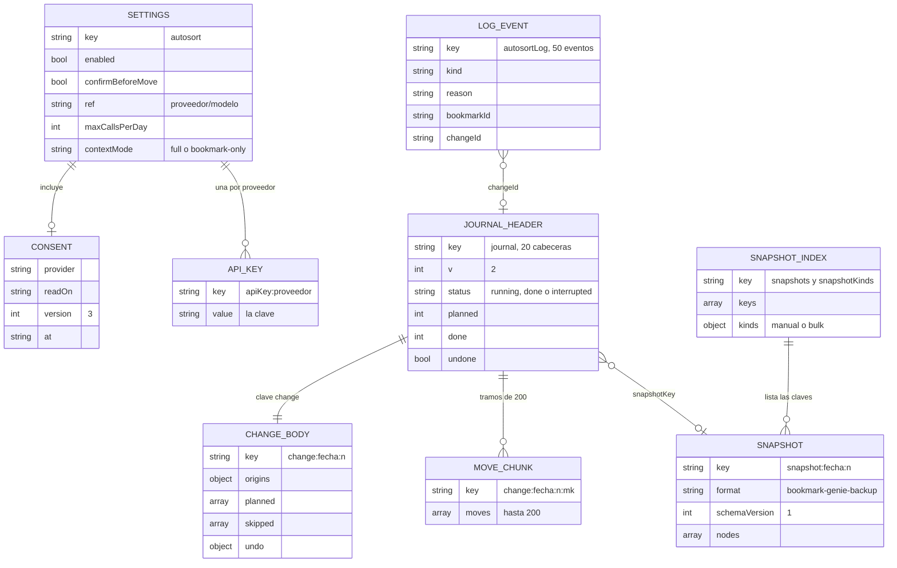
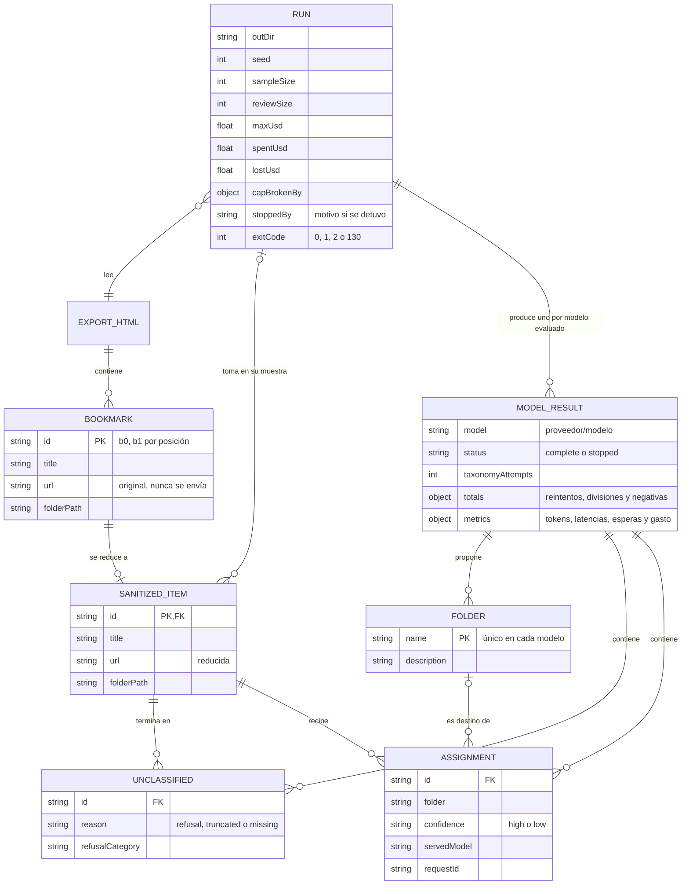
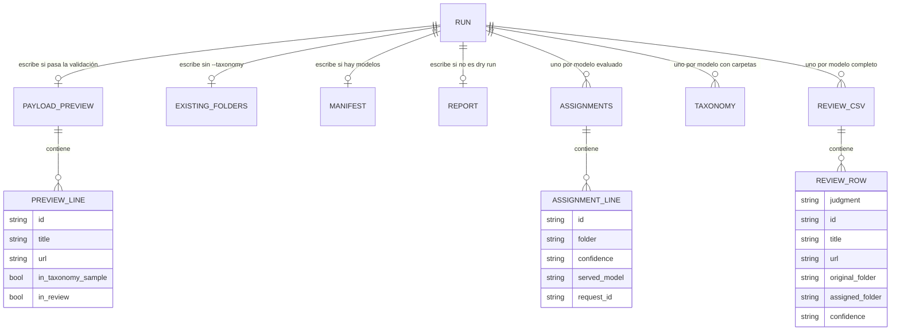

# Estructura de datos

Hay dos conjuntos de datos que no se tocan entre sí. La **extensión** guarda su estado en `chrome.storage.local`, dentro del perfil de Chrome. La **herramienta de evaluación** (`tools/`) no guarda estado: escribe archivos en un directorio nuevo por corrida. Comparten el núcleo (`extension/core/`), no los datos.

## Almacenamiento de la extensión

Todo vive en [`chrome.storage.local`](https://developer.chrome.com/docs/extensions/reference/api/storage) del perfil. El permiso `unlimitedStorage` quita el tope de 10 MB, y los datos se borran al quitar la extensión: lo que sobrevive a eso son los archivos que descarga «Respaldar ahora». Nunca se usa `storage.sync`, y el worker declara `setAccessLevel({accessLevel: 'TRUSTED_CONTEXTS'})` para que un futuro script de contenido no lea la clave (hoy no hay ninguno).

Cada escritura que lee antes de escribir toma un candado de `navigator.locks` (`bookmark-genie:<nombre>`), compartido entre el worker y las páginas: `journal`, `settings`, `proposals`, `usage`, `log` y `metrics`. Así dos escritores no se pierden entre sí. La clave y los ajustes se escriben sin candado, en la primera instrucción de su función, para que la página pida permisos en el mismo clic.

### Claves

Las relaciones del diagrama existen todas a la vez; no son pasos.



Quedan seis claves sueltas, sin relación estructural con las anteriores: `proposals`, `autosortUsage`, `autosortErrors`, `autosortMetrics`, `autosortLastSent` y `autosortLastResult`. La tabla las describe todas.

| Clave | Forma | Retención | Versión | Candado |
|---|---|---|---|---|
| `autosort` | Ajustes: `enabled`, `confirmBeforeMove`, `ref`, `maxCallsPerDay`, `contextMode`, `excludedFolderIds`, `excludedFolders` (`[{id, path}]`) y `consent` (`{provider, readOn, version, at}` o `null`) | Hasta que la persona los cambie | Sin campo de versión: `normalizeSettings` completa lo que falte con sus valores por omisión (así leen los de 0.3.0). `consent.version` es 3; uno de versión 1 o 2 no cubre y se pide otra vez | Ninguno: se escribe entero y de una vez |
| `apiKey:<proveedor>` | Cadena con la clave, una clave de almacenamiento por proveedor | Hasta «Borrar clave» o desinstalar | Sin versión. `apiKeys` (un mapa) es la forma de 0.3.0: se sigue leyendo, y `saveKey` y `deleteKey` la limpian | `settings`, solo para limpiar el mapa viejo |
| `autosortUsage` | `{day, calls, spentUsd, lostUsd}`. `day` es el día **local** `AAAA-MM-DD` | Solo hoy: un registro de otro día cuenta como vacío y se sobrescribe en la siguiente escritura | Ninguna | `usage` |
| `autosortLog` | Arreglo de eventos, el más nuevo primero. Ver [evento del registro](#evento-del-registro-autosortlog) | 50 eventos; el más viejo cae | Ninguna | `log` |
| `autosortErrors` | `{count, category, at}`: errores que la persona aún no vio. Muestra la «!» roja | Hasta que una ventana llama `ackErrors()` al abrirse | Ninguna | `log` |
| `autosortMetrics` | `{weeks: {'AAAA-Www': {moved, accepted, discarded, undone, corrected, expired, filed, undoneBookmarks, looseAccepted, looseDiscarded, looseFiled}}, totals: {accepted, corrected}}`. Contadores, sin títulos | 12 semanas. `totals` no se reinicia nunca: de ahí sale la sugerencia de pasar a automático | Ninguna | `metrics` |
| `autosortLastSent` | Lo que salió en la última llamada: conteos y `sent: {bookmark: {title, host}, folders: [{name, examples}], loose: [{title, host}]}`. Sin URL | Solo la última; se escribe tras reservar la llamada | Ninguna | Ninguno |
| `autosortLastResult` | `{at, kind, messageEs, changeId?}`: el último resultado que muestra la franja de la ventana | Hasta la próxima acción o «Cerrar» | Ninguna | Ninguno |
| `proposals` | Arreglo de propuestas, la más vieja primero. Ver [propuesta](#propuesta-proposals) | 50; caducan a los 14 días | Sin campo de versión: `normalize` completa `confidence`, `origin` y `reason` en las de 0.3.0 | `proposals` |
| `journal` | Arreglo de cabeceras de cambio, la más vieja primero. Ver [cambio](#cambio-journal-y-change) | 20 cabeceras; al caer una se borran su cuerpo y sus tramos | `v: 2` en cada cabecera. Una entrada sin `v` es de 0.3.0 y se convierte en la primera lectura o escritura, de forma idempotente | `journal` |
| `change:<fecha>:<n>` | Cuerpo de un cambio: `{origins, planned, skipped, undo}`. La `fecha` es la ISO de creación | Con su cabecera | La de su cabecera | `journal` |
| `change:<fecha>:<n>:m<k>` | Tramo `k` de movimientos de ese cambio, hasta 200 cada uno, escrito cuando se llena | Con su cabecera | La de su cabecera | `journal` |
| `snapshots` y `snapshotKinds` | Lista de claves de instantáneas (la más vieja primero) y un mapa clave → `manual` o `bulk` | 3 de cada clase | Ninguna | `journal` |
| `snapshot:<fecha>:<n>` | Un objeto [`backup@1`](#backup1json) completo | Con su lista | `schemaVersion: 1` | `journal` |

Además hay dos cosas que **no** están en `chrome.storage`:

- `localStorage` de la página de la ventana guarda `lastBackupAt`, la fecha del último respaldo, solo para el recordatorio. Es del navegador y de esa página: el worker no lo ve.
- Los archivos que «Respaldar ahora» descarga a Descargas: `bookmark-genie-<fecha>.html` y `bookmark-genie-<fecha>.backup@1.json`.

`sweepOrphans()` borra las claves `change:*` y `snapshot:*` a las que ninguna cabecera ni lista apunta, por si un worker murió entre dos escrituras. Hoy nada la llama sola.

### Evento del registro (`autosortLog`)

| Campo | Descripción |
|---|---|
| `id`, `at` | Identidad y fecha ISO |
| `kind` | `moved`, `proposed`, `left`, `error`, `expired`, `duplicate` o `sorted` (el resumen de «Ordenar sueltos») |
| `title`, `host` | Título cortado a 80 caracteres y limpio, y host. Nunca la URL |
| `reason` | Por qué se dejó o qué falló (`saved-in-folder`, `no-topic`, `confirm-mode`, `low-confidence`…) |
| `category` | Categoría de error: `key`, `quota`, `server`, `timeout`, `model`, `permission`, `no-key` o `daily-cap` |
| `detail` | Las palabras del proveedor, cortadas a 200 caracteres y con la clave enmascarada. Solo para «Detalles» |
| `folder`, `newFolder` | Carpeta de destino, y si es nueva |
| `bookmarkId`, `changeId`, `duplicateOf` | Enlaces al marcador, al cambio del diario (para «Deshacer») y al marcador que ya existía |
| `ms`, `accepted`, `origin`, `truncation`, `counts` | Latencia; si lo aceptó la persona; `sort-loose`; `{sent, total}` de carpetas si el contexto se recortó; conteos del resumen de «Ordenar sueltos» |

Una propuesta aceptada reescribe su fila `proposed` a `moved` (con `changeId`); una descartada, a `left` con `reason: discarded`.

### Propuesta (`proposals`)

```json
{
  "id": "proposal:2026-11-05T21:00:00.000Z:42",
  "createdAt": "2026-11-05T21:00:00.000Z",
  "kind": "create",
  "confidence": "high",
  "origin": "ctrl-d",
  "bookmark": {"id": "42", "title": "Ranking de LLM", "host": "sevenlab.ai", "parentId": "1", "index": 11},
  "newFolder": {"parentId": "1", "parentTitle": "Barra de marcadores", "name": "IA", "description": "Modelos y herramientas de IA"},
  "together": [{"id": "17", "title": "…", "host": "…", "parentId": "1", "index": 3}]
}
```

- `kind` `move` lleva `folder: {id, name}` y `reason` (`confirm-mode` o `low-confidence`); `create` lleva `newFolder`. En un `create`, `together` son los sueltos que irían con él.
- `origin` es `ctrl-d` o `sort-loose`. En un grupo de «Ordenar sueltos», `bookmark` es solo el primero del grupo: se puede desmarcar como los demás.
- Guarda `parentId` e `index` de origen: si el marcador ya no está en ese padre, la propuesta está obsoleta y se descarta sola.

### Cambio (`journal` y `change:*`)

Cabecera (en `journal`):

| Campo | Descripción |
|---|---|
| `v` | 2 |
| `id`, `kind`, `label` | `change:<fecha>:<n>`; `sort` (automático), `proposal`, `manual` («Elegir carpeta»); y un texto corto sin URL |
| `createdAt`, `touchedAt`, `finishedAt` | `touchedAt` es el latido: un cambio `running` sin latido de 60 s se considera abandonado |
| `status` | `running`, `done` o `interrupted` |
| `planned`, `done`, `skipped`, `chunks` | Conteos. En la cabecera `skipped` es un número |
| `createdFolders` | Carpetas que este cambio creó; Deshacer las borra si quedaron vacías |
| `snapshotKey` | Instantánea previa, o `null` (hoy siempre `null`) |
| `undone`, `undoAt`, `undoing`, `undoable` | Estado de Deshacer. `undoing` es la hora en que alguien reclamó el Deshacer, y vence a los 60 s. `undoable` se calcula: no deshecho y con al menos un movimiento hecho |

Cuerpo (`change:<id>`): `origins` (los ids hijos de cada carpeta de origen, en orden, antes del primer movimiento), `planned` (los movimientos previstos), `skipped` (`{id, title?, reason, message?}`) y `undo` (`{at, restored, skipped, removedFolders, keptFolders}` o `null`). Cada movimiento de un tramo es `{id, from: {parentId, index}, to: {parentId, index}}`; los índices son informativos, porque Deshacer coloca cada nodo tras su antecesor vivo más cercano.

Un cambio que no movió nada no se guarda.

### `backup@1.json`

Es el formato de `core/backup.js`: `{format: 'bookmark-genie-backup', schemaVersion: 1, createdAt, roots, nodes}`. `roots` lista los ids de las raíces en orden. `nodes` lleva todos los nodos menos la raíz del árbol, en profundidad primero, así que un padre siempre va antes que sus hijos. Cada nodo: `id`, `parentId`, `index`, `title`, `url?`, `dateAdded?`, `folderType?` (solo en las raíces) y `syncing`. Agregar un campo conserva la versión 1; quitar o redefinir uno exige `schemaVersion` 2. `parseBackup` valida ids únicos, padres listados antes, índices contiguos y `folderType` solo en las raíces.

Contiene las URL **completas**. Los archivos descargados quedan en claro en Descargas.

### Hoy no existe

No hay IndexedDB, ni etiquetas, ni checkpoints, ni cuarentena. La restauración desde `backup@1.json` no está construida: el archivo se puede leer y validar (`parseBackup`), pero ningún botón lo aplica. El diseño de esos almacenes está en [Decisiones](decisiones.md#esquema-de-indexeddb).

## Datos de la herramienta de evaluación (M0)

La herramienta **no tiene base de datos**. Los datos viven en memoria durante la corrida y terminan en archivos bajo un directorio de salida (`--out`, por defecto `eval-out/<fecha y hora>` en la raíz del proyecto). Ese directorio **debe ser nuevo**: si existe, la corrida falla con `Refusing to reuse <ruta>: it already exists, and a new run would overwrite its reviews. Choose a new directory.` La herramienta lo crea con modo 700 y cada archivo con modo 600, y no escribe a través de un enlace simbólico. `eval-out/` está en `.gitignore`.

Para una corrida real conviene un `--out` dentro de un directorio privado de tu cuenta, porque el directorio del proyecto es compartido ([por qué](decisiones.md#escritura-de-archivos)).

`autosort-check` escribe también en su `--out` (directorio 700, archivos 600): `requests-preview.jsonl`, `answers-<modelo>.jsonl`, `review-<modelo>.csv`, `check-manifest.json` (con la huella del prompt) y `report.md`.

### Diagramas de entidades

Son entidades lógicas, no tablas. Las líneas son relaciones que existen a la vez, no pasos de un proceso.

#### Datos en memoria



Cuatro reglas que el diagrama no puede expresar:

- Por cada modelo **completo**, un marcador de la muestra termina en exactamente una de `ASSIGNMENT` o `UNCLASSIFIED`.
- Una `ASSIGNMENT` con `folder = __unsorted__` no tiene `FOLDER` asociada; por eso esa relación es opcional.
- Un modelo que se detiene **conserva** lo que había resuelto: sus asignaciones ya están en `assignments-*.jsonl` y el reporte las cuenta (`INCOMPLETE`). Lo que no resolvió cuenta como `not attempted`. No genera CSV de revisión.
- `ASSIGNMENT.servedModel` es lo que el proveedor dice que respondió, y es lo que fija la verdad del modelo; el precio de un intento sale del catálogo.

#### Archivos de una corrida



### Entidades en memoria

#### Marcador leído (`parseNetscapeBookmarks`)

| Campo | Tipo | Descripción |
|---|---|---|
| `id` | string | Posición en el archivo (`b0`, `b1`...). Solo es estable dentro de una exportación; no es el ID de Chrome |
| `title` | string | Título con entidades HTML decodificadas |
| `url` | string | URL original. Se usa solo para sanearla |
| `folderPath` | string | Ruta separada por `/`; vacía si está directo en la barra o fuera de toda carpeta |

#### Resultado de `sanitizeForLlm`

| Campo | Tipo | Descripción |
|---|---|---|
| `sendable` | boolean | Si puede salir de la máquina |
| `url` | string | Solo si es enviable: host reducido y hasta 4 segmentos de ruta |
| `reason` | string | Solo si no es enviable: `invalid-url`, `unsupported-scheme` o `private-host`. Con `--exclude-folder` se agrega `excluded-folder` |

#### Carpeta (`Folder`)

| Campo | Tipo | Descripción |
|---|---|---|
| `name` | string | Hasta 60 caracteres y 2 niveles (`Padre/Hijo`), único sin distinguir mayúsculas |
| `description` | string | Frase corta de hasta 160 caracteres que orienta la clasificación |

#### Asignación (`Assignment`)

| Campo | Tipo | Descripción |
|---|---|---|
| `id` | string | Marcador |
| `folder` | string | Nombre de la carpeta, o `__unsorted__` si ninguna sirve |
| `confidence` | string | `high` o `low`, en minúsculas tras normalizar |
| `servedModel` | string | Modelo que respondió esa petición, según el proveedor |
| `requestId` | string o null | Identificador de la petición, si el proveedor lo informa |

#### Sin clasificar (`Unclassified`)

| Campo | Tipo | Descripción |
|---|---|---|
| `id` | string | Marcador |
| `reason` | string | `refusal`: el modelo se negó. `truncated`: se agotó `max_tokens`. `missing`: siguió faltando tras reintentar |
| `refusalCategory` | string o null | Solo la categoría de política que informa el proveedor, nunca el texto de la negativa |

#### Puerto `complete(request)`

| Entrada | Tipo | Descripción |
|---|---|---|
| `system` | string | Instrucciones fijas |
| `user` | string | Carpetas y marcadores, en JSON con `<` escapado |
| `schema` | object | Esquema JSON de la respuesta |
| `maxTokens` | number | Al clasificar, `min(16000, margen + 40 × marcadores)`. Al proponer carpetas, `min(16000, margen + 2048)`. El margen reserva el razonamiento y depende del esfuerzo: `none` 0, `low` 2048, `medium` 4096, `high` 8192. Son valores de partida, sin medir contra una API real |

| Salida | Tipo | Descripción |
|---|---|---|
| `data` | any | JSON de la respuesta; `null` si hubo rechazo o el JSON no es válido |
| `stopReason` | string | `end_turn`, `max_tokens` o `refusal`, neutral entre proveedores |
| `refusalCategory` | string o null | Categoría de la negativa, si la hay |
| `servedModel` | string | El modelo que respondió |
| `requestId` | string o null | Identificador de la petición |
| `usage` | object | `attempts` (cada intento a la tarifa de su modelo), más `inputTokens`, `outputTokens` (incluye razonamiento), `thinkingTokens` y `usedFallback`, sumando todos los intentos |
| `latencyMs` | number | Duración de la llamada |

### Contrato con el modelo

Los nombres de carpeta viajan en el mensaje, no en el esquema, porque la API guarda los esquemas en caché hasta 24 horas aparte del contenido.

Petición de clasificación (contenido de `user`):

```text
<folders>
[{"f":0,"name":"Cocina","description":"Recetas y técnicas"}]
</folders>
<bookmarks>
[{"i":0,"title":"Pan de masa madre","url":"example.com/blog/pan"}]
</bookmarks>
```

Respuesta:

```json
{"assignments": [{"i": 0, "f": 0, "confidence": "high"}]}
```

| Campo | Tipo | Validación local |
|---|---|---|
| `i` | integer | Dentro del lote. Cada marcador necesita exactamente una entrada válida |
| `f` | integer | Carpeta existente, o `-1` para ninguna |
| `confidence` | string | `high` o `low`, sin distinguir mayúsculas |

Respuesta de propuesta de carpetas:

```json
{"folders": [{"name": "Cocina", "description": "Recetas y técnicas"}]}
```

En DeepSeek, que solo ofrece modo JSON, el esquema viaja además en el prompt del sistema y nada lo impone; la validación local es la única barrera.

### Archivos de salida

| Archivo | Cuándo | Contenido |
|---|---|---|
| `payload-preview.jsonl` | Si pasa la validación, también con `--dry-run` | Una línea por marcador de las muestras que viajarían |
| `existing-folders.json` | Igual, salvo con `--taxonomy` | Nombres de carpeta existentes que viajan en la propuesta |
| `manifest.json` | Si hay modelos (también en un dry run con `--models`) | Registro auditable de la corrida; se reescribe tras cada paso |
| `assignments-<modelo>.jsonl` | Por cada modelo evaluado, una línea por respuesta | Lo resuelto, escrito antes de la siguiente llamada |
| `taxonomy-<modelo>.json` | Por cada modelo cuya propuesta produjo carpetas, o con `--taxonomy` | Carpetas, descartadas y de cuántos marcadores salieron |
| `review-<modelo>.csv` | Por cada modelo **completo** | Filas para juzgar; los mismos marcadores en todos los modelos |
| `report.md` | Corrida real, aunque se detenga | Vista para personas, sin contrato |
| `blind.csv` y `blind.key.json` | Los escribe `blind`, no `run` | Lista ciega y su clave |

`<modelo>` es la referencia con cada tramo fuera de `[A-Za-z0-9._-]` reemplazado por `__`: `anthropic/claude-haiku-5-5` pasa a `anthropic__claude-haiku-5-5`, y `perplexity/openai/gpt-6-luna` a `perplexity__openai__gpt-6-luna`.

#### `manifest.json`

Es lo que hace auditable una corrida: la respuesta de un modelo no se reproduce, así que el manifiesto dice qué entrada, muestra, prompts, código y precios la produjeron. Esquema `bookmark-genie/run-manifest@1`. Agregar un campo no cambia la versión; renombrar o quitar uno, sí. Lo que analiza una corrida (`score`, `blind`) lee el manifiesto, no `report.md`.

| Campo | Descripción |
|---|---|
| `run_id`, `started_at`, `finished_at` | Identidad y tiempos |
| `status` | `running`, `complete` o `stopped`. `complete` exige todos los modelos completos (salvo en un dry run); ya no acepta cambios |
| `exit_code` | 0, 1, 2 o 130. Con todos los modelos completos puede ser 2 |
| `stopped_by` | Motivo de la detención, ya sin credenciales; nulo si terminó bien |
| `tool` | `code_sha256` (huella de `extension/`, `tools/` y `package-lock.json`, comprobable con `sha256sum`), `node` y `anthropic_sdk` (leída del paquete instalado) |
| `input` | `sha256` y `bytes` del archivo, `bookmarks`, `sendable` y `excluded` (conteo por motivo) |
| `params` | Lo pedido en la línea de comandos: `seed`, `sample`, `review`, `language`, `max_usd`, `effort`, `fallback`, `dry_run`, `max_folders`, `exclude_folder`, `taxonomy_file_sha256` y `models` |
| `sample_size`, `review_size`, `taxonomy_sample_size` | Tamaños de las tres muestras |
| `sample_sha256`, `review_sha256`, `taxonomy_sample_sha256` | Huella del **conjunto** de `id`, ordenados. `score` y `blind` comparan contra `review_sha256`: reordenar el CSV no la altera, borrar o repetir una fila sí |
| `quality` | Conteos de duplicados, títulos vacíos, título igual a la URL y URL reducida al host. Solo cantidades |
| `prices_usd_per_mtok` | Precio, fecha de lectura y fuente de cada modelo, por `proveedor/modelo` |
| `spent_usd` | Gasto total acumulado, incluidos los cargos al peor caso |
| `lost_usd` | La parte de `spent_usd` cargada por llamadas que no dieron una respuesta utilizable (`charged for calls that gave no usable answer`): el uso real si se leyó y, si no, el peor caso |
| `cap_broken_by` | Nulo, o `{model, max_tokens, output_tokens}` si un proveedor devolvió más salida que `max_tokens`: el tope no se puede garantizar con él |
| `models[]` | Un elemento por modelo, abajo |

Cada elemento de `models[]`:

| Campo | Descripción |
|---|---|
| `requested`, `provider` | Referencia pedida y su proveedor |
| `status` | `pending`, `running`, `complete` o `stopped` |
| `endpoint`, `key_suffix` | Origen del destino y últimos 4 caracteres de la clave; nunca la clave |
| `data_policy` | La política que se mostró antes de enviar, con fuente y fecha |
| `effort` | Esfuerzo que **realmente** viajó; `null` si el modelo no confirma ese nivel |
| `fallback` | Si el respaldo del servidor estuvo realmente activo |
| `prompts` | Huella del prompt de clasificación y del de carpetas, calculada con datos vacíos: cubre sistema, plantilla, esquema y `maxTokens` |
| `served` | Conteo de asignaciones por modelo servido. Sustituye al antiguo `served_calls` |
| `answered_by` | Conteo de **llamadas** por modelo que respondió, taxonomía incluida. `score` y `blind` bajan a `GRAY` si aparece otro modelo en `served` o aquí |
| `taxonomy_sha256`, `dropped` | Huella de las carpetas y conteo de propuestas descartadas por motivo |
| `classified`, `unclassified`, `unclassified_reasons` | Lo resuelto, y lo no resuelto por motivo (`refusal`, `truncated`, `missing`) |
| `input_tokens`, `output_tokens`, `thinking_tokens` | Tokens reales; la salida incluye razonamiento |
| `spent_usd`, `lost_usd` | Gasto de ese modelo y la parte cargada por llamadas sin respuesta útil |
| `stopped_by` | Motivo si se detuvo |

`score` ordena por `spent_usd - lost_usd`. Ya no existen `served_calls` ni `strata`.

#### `payload-preview.jsonl`

| Campo | Descripción |
|---|---|
| `id` | Posición en la exportación (`b317`) |
| `title` | Título tal como lo vería el modelo: sin caracteres de control o invisibles, con correos, URL y tokens enmascarados (`[email]`, `[url]`, `[id]`), cortado a 150 caracteres |
| `url` | URL reducida |
| `in_taxonomy_sample` | Si viaja en la propuesta de carpetas |
| `in_review` | Si cae en las filas de revisión |

Aunque la consola dice «Preview of the titles and URLs that would leave», **es una aproximación a nivel de datos, no la petición literal**: la petición agrega el prompt, la lista de carpetas y el esquema. Con `--taxonomy`, el archivo solo trae la muestra de clasificación, porque no hay propuesta de carpetas. `folderPath` no se muestra: solo viajan, en la propuesta de carpetas, las hasta 60 rutas más pobladas.

#### `existing-folders.json`

Arreglo con hasta 60 nombres de carpeta (los más poblados de **toda** la colección enviable, recortados a 2 niveles y de hasta 60 caracteres). Un nombre se omite si el enmascarado de títulos lo alteraría, porque contendría un correo o un token. Es exactamente lo que viaja como `existing_folders`.

#### `assignments-<modelo>.jsonl`

Una línea JSON por marcador resuelto, agregada con `O_APPEND` y sin seguir enlaces simbólicos, antes de la siguiente llamada. Un lector debe tolerar una última línea cortada si el proceso murió.

```json
{"id":"b12","folder":"Cocina","confidence":"high","served_model":"claude-haiku-5-5","request_id":"req_..."}
{"id":"b31","unclassified":"refusal","refusal_category":"..."}
```

#### `taxonomy-<modelo>.json`

```json
{"folders": [{"name": "Cocina", "description": "Recetas"}], "dropped": [], "built_from": 150, "source": "model"}
```

`source` es `model` o `file` (con `--taxonomy`). Con la propuesta del modelo, se reescribe de forma atómica antes de cada intento, para que una taxonomía pagada no se pierda si un intento posterior falla. Es el formato que acepta `--taxonomy`, y se puede editar a mano.

#### `review-<modelo>.csv`

| Columna | Descripción |
|---|---|
| `judgment` | Vacía; la llenas con `y`, `yes`, `s`, `si`, `sí`, `n` o `no` |
| `id` | Marcador. `score` lo usa para comprobar que las filas son las de la corrida |
| `title` | Título como lo vio el modelo |
| `url` | URL reducida |
| `original_folder` | Carpeta actual, vacía si estaba suelto |
| `assigned_folder` | Carpeta propuesta, `__unsorted__` o `(unclassified)` |
| `confidence` | `high`, `low` o vacía si no se clasificó |

Todas las celdas van entre comillas. Una celda que empieza con `=`, `+`, `-` o `@` (también las formas de ancho completo, o precedidas por espacio) se prefija con `'` para que una hoja de cálculo no ejecute un título como fórmula, y se quitan los caracteres de control y los invisibles. Al leerlo, `score` acepta BOM, CRLF, filas vacías, coma o punto y coma como separador, y UTF-8 o Windows-1252 (lo que Excel suele guardar).

#### `blind.csv` y `blind.key.json`

La lista tiene las columnas `judgment`, `row` (`r1`, `r2`...), `title`, `url` y `folder`: sin modelo, confianza ni carpeta original. La clave (`bookmark-genie/blind-key@1`) guarda `seed`, `input_sha256`, `review_sha256`, qué par es cada fila y cuáles se repiten (`rows`), los juicios arrastrados con `--previous` (`carried`) y, por brazo, su etiqueta, modelo, esfuerzo, costo neto, completitud y respuestas (`arms`). Ambos van en modo 600 y nunca se sobrescriben.

#### Métricas de `report.md`

Es una vista para personas; no tiene contrato. Por cada modelo:

| Métrica | Descripción |
|---|---|
| `M0 completeness` | `PASS` o `FAIL` con `missing` y `not attempted`. Solo `missing` y lo no intentado bloquean |
| Status / effort | Estado y esfuerzo realmente enviado |
| Placed in a folder | Marcadores en una carpeta real, sobre la muestra |
| Sent to unsorted | Marcadores para los que ninguna carpeta servía |
| Missing after retries | Sin clasificar por `missing` |
| Refused or truncated | Sin clasificar por `refusal` o `truncated` (sin contar `missing`), con su proporción sobre la muestra, o sobre lo intentado si el modelo no terminó. Sobre 2 % el reporte avisa |
| Low confidence | Asignaciones con baja confianza |
| Folders used / proposed | Carpetas con al menos un marcador, sobre las propuestas (o las del archivo) |
| Largest folder share | Proporción de la carpeta mayor |
| Proposals discarded, Taxonomy built from | Solo con propuesta del modelo: descartadas y de cuántos marcadores salió, con intentos, negativas y truncados |
| Invalid entries before retrying | Entradas inválidas, más cada repetición de un índice sin contar su primera aparición |
| Retries / splits | Reintentos y divisiones de lote, solo al clasificar |
| Refusals / truncations (classification) | Rechazos y truncados al clasificar; la propuesta de carpetas no se cuenta aquí |
| Responses served by a fallback model | Respuestas del respaldo del servidor |
| Models that answered (calls) | Modelos que respondieron, con su conteo. Un modelo distinto del pedido genera `Unexpected model answered` |
| API calls ok / failed / rate-limit waits | Llamadas exitosas, fallidas y esperas |
| Latency per call p50 / p95 | Latencia de las llamadas exitosas |
| Tokens in / out (out includes reasoning) | Tokens reales |
| Reasoning tokens total / largest single call | Razonamiento total y mayor en una llamada |
| Cost of this run | Calculado con el precio del catálogo; si hubo cargos por llamadas sin respuesta útil, se nombra esa parte; si el modelo tiene una nota (por ejemplo, DeepSeek a tarifa de pico), se muestra al lado |
| Projected cost per 2000 bookmarks | La llamada de carpetas se cuenta una vez y lo cargado por llamadas sin respuesta útil (`lost_usd`) se descuenta, porque no crece con la colección; el resto se escala linealmente desde la muestra. Con `--taxonomy` la estimación usa las carpetas del archivo y no suma la petición de carpetas. Aproximado; sin el «±15 %» cuando el modelo tiene una nota |

Arriba de las secciones: gasto total contra el tope, `The spending cap was crossed`, `The cap cannot be trusted with ...` si hay `cap_broken_by`, `Stopped early` con el motivo y los conteos de calidad de datos.
