# Funcionalidades

## Cómo leer los diagramas

| Elemento | Significado |
|---|---|
| Rombo en un flujo | Decisión exclusiva: se sigue **exactamente una** salida. Tiene al menos 2, todas rotuladas |
| Rectángulo en un flujo | Paso: tiene una sola salida, o ninguna si termina el flujo |
| Rombo pequeño en un diagrama de estados | Punto de decisión (`choice`). Las condiciones entre corchetes son excluyentes y cubren todos los casos |
| Estado sin salidas | Estado final |
| Flechas en diagramas de componentes y entidades | Relaciones que existen todas a la vez. No son caminos ni decisiones |

**En la evaluación (M0) nada corre en paralelo.** Marcadores, modelos, lotes y mitades de lote se procesan uno tras otro, y hay una sola llamada a un proveedor en vuelo. El código no usa workers ni temporizadores repetitivos. `Promise.all` aparece solo para leer archivos locales (`score` y la huella del código), y `Promise.race` para abandonar la llamada en vuelo cuando llega una señal. Si una caja o un estado parece tener varias salidas, solo se toma una.

**En la extensión sí pueden coincidir varios eventos:** dos Ctrl+D seguidos, el worker y la ventana escribiendo a la vez. Cada diagrama muestra el camino de **un** evento; la exclusión entre escritores la da el [candado](arquitectura-alto-nivel.md#el-candado), que no se dibuja.

**Lo único que no se dibuja:** un fallo al escribir archivos o al cargar el SDK puede ocurrir en varios puntos de la evaluación, y siempre termina con salida 1 y el mensaje del sistema. En la extensión, un fallo inesperado se registra como un evento `error` de categoría `server` y no detiene al worker.

**La evaluación no se reanuda.** Ningún diagrama tiene una flecha que vuelva a una corrida terminada o detenida. Lo pagado queda en disco, pero repetir un `run` es una corrida nueva, con otro `--out`, que vuelve a pagar. «Ordenar sueltos» tampoco se reanuda: lo ya clasificado se propone y el resto se vuelve a pedir.

## Implementadas

### Extensión 0.5.1

| Funcionalidad | Detalle | Código |
|---|---|---|
| Orden con Ctrl+D | Apagado por defecto. Al guardar la página activa directamente en la barra, en Otros o en Celular, espera unos 8 s y pide a la IA una carpeta existente, una carpeta nueva o ninguna. Detalle y guardas: [flujo](#flujo-de-ctrld-de-punta-a-punta) | [autosort.js](../extension/platform/autosort.js), [sw.js](../extension/sw.js) |
| «Confirmar antes de mover» | Encendido por defecto: toda respuesta es una propuesta. El modo automático solo mueve cuando la IA dice `existing` con confianza alta. La extensión sugiere el automático con 20 propuestas aceptadas sin cambios y a lo más 1 corregida | [autosort.js](../extension/platform/autosort.js), [flow.js](../extension/platform/flow.js) |
| Propuestas | Mover a una carpeta existente, o crear una carpeta y llevar los sueltos que comparten tema. Nombre editable, otra carpeta en un selector, «Crear solo con este», «Aceptar las N de X». Tope de 50, caducan a los 14 días | [proposals.js](../extension/platform/proposals.js), [ui/proposals.js](../extension/ui/proposals.js) |
| Deshacer por cambio | Cada movimiento de la extensión es un cambio del diario, con su propio Deshacer; «Aceptar todas» y «Aceptar las N de X» son un solo cambio. Devuelve cada nodo a su lugar y borra la carpeta creada si quedó vacía. Los últimos 20 cambios | [bookmarks.js](../extension/platform/bookmarks.js), [store.js](../extension/platform/store.js) |
| «Ordenar sueltos» | Bajo demanda, con confirmación previa de lo que saldrá. Propone carpetas para los sueltos de una carpeta; nunca mueve solo | [autosort.js](../extension/platform/autosort.js), [sort-loose.js](../extension/core/sort-loose.js) |
| Duplicados al guardar | Si la URL ya está guardada, no hay llamada: registra «Ya lo tenías en X» y ofrece «Quitar el duplicado nuevo» | [autosort.js](../extension/platform/autosort.js) |
| Ajustes | Modelo, clave (con «Probar la clave» y «Borrar clave»), política de datos y consentimiento, contexto (completo o solo el marcador), carpetas excluidas y tope de llamadas por día | [ui/options.js](../extension/ui/options.js), [settings.js](../extension/platform/settings.js) |
| Actividad y último resultado | Hasta 50 eventos con su motivo en español y sus acciones (Deshacer, Elegir carpeta, Reintentar, Quitar el duplicado). La franja del último resultado sobrevive a cerrar la ventana | [flow.js](../extension/platform/flow.js), [ui/manager.js](../extension/ui/manager.js) |
| Insignia | «!» roja si hay errores sin ver, el número de pendientes en azul, «✓» verde por 15 s tras un movimiento automático | [proposals.js](../extension/platform/proposals.js) |
| Tope diario | 50 llamadas (editable, 1 a 1000) y US$0,10 a tarifa de pago. La llamada se reserva antes de enviar y se devuelve si no pudo facturarse | [autosort.js](../extension/platform/autosort.js) |
| Errores en español | Ocho categorías con su texto y su acción. Un 429 no se reintenta | [core/autosort.js](../extension/core/autosort.js) |
| Qué se envió | «Ver qué se envió» lista el marcador, las carpetas con sus ejemplos y los sueltos de la última llamada, con título y host | [ui/autosort.js](../extension/ui/autosort.js) |
| Métrica semanal | Una línea con lo ubicado, aceptado, corregido, descartado y deshecho de la semana, sin títulos | [flow.js](../extension/platform/flow.js) |
| Respaldo | «Respaldar ahora» descarga un HTML que Chrome puede importar y un `backup@1.json`, y guarda el árbol en el almacenamiento. Recordatorio si pasan 14 días | [ui/manager.js](../extension/ui/manager.js), [backup.js](../extension/core/backup.js) |
| Recuperación | Si el worker muere a medias de un cambio, al arrancar se concilia con el árbol real | [bookmarks.js](../extension/platform/bookmarks.js) |

### Evaluación (M0)

| Funcionalidad | Detalle | Código |
|---|---|---|
| Lectura de exportación | Interpreta el HTML de Chrome; la barra de marcadores no cuenta como carpeta | [netscape.mjs](../tools/lib/netscape.mjs) |
| Saneamiento de URL y título | Reduce la URL, excluye hosts no públicos y esquemas no web, y enmascara correos, URL y tokens dentro de los títulos | [url.js](../extension/core/url.js), [prompt.js](../extension/core/prompt.js) |
| Exclusión por carpeta | `--exclude-folder`, repetible, nunca envía lo que coincide. Un patrón sin coincidencias es error antes de enviar (solo advierte en `--dry-run`) | [url.js](../extension/core/url.js), [args.mjs](../tools/lib/args.mjs) |
| Muestreo reproducible | Tres muestras con semilla: carpetas, clasificación (aleatoria simple de lo que la propuesta no vio) y revisión | [sampling.js](../extension/core/sampling.js) |
| Propuesta de carpetas | El modelo propone carpetas de máximo 2 niveles, con un límite de entre 5 y 30 según la raíz cuadrada de la colección; o se usan las de `--taxonomy` | [taxonomy.js](../extension/core/taxonomy.js) |
| Clasificación por lotes | El modelo responde solo con números de marcador y de carpeta, y un nivel de confianza | [classify.js](../extension/core/classify.js) |
| Recuperación ante fallos del modelo | Reintenta faltantes y divide porciones rechazadas o truncadas | [classify.js](../extension/core/classify.js) |
| Varios proveedores | `--models proveedor/modelo` sobre un catálogo con precio, fuente y fecha. Siete proveedores; solo Gemini 3.5 Flash-Lite se probó con una corrida real | [Proveedores](proveedores.md) |
| Control de gasto | Tope compartido por todos los modelos, cobro de lo que pudo facturarse sin respuesta útil (`lost_usd`: uso real si se leyó, si no el peor caso) y guardia para un proveedor que no respeta `max_tokens` (`cap_broken_by`) | [budget.js](../extension/core/budget.js) |
| Consentimiento de datos | `--accept-data-policy` para Gemini, Mistral y DeepSeek | [providers.js](../extension/platform/providers.js) |
| Vista previa sin envío | `--dry-run` no necesita clave ni red | [runner.mjs](../tools/lib/runner.mjs) |
| Escritura incremental | Cada respuesta pagada se escribe antes de la siguiente llamada; el manifiesto se actualiza tras la taxonomía y tras cada lote | [runner.mjs](../tools/lib/runner.mjs), [manifest.mjs](../tools/lib/manifest.mjs) |
| Señales | `SIGINT`, `SIGTERM` y `SIGHUP` detienen con salida 130 y escriben manifiesto y reporte | [runner.mjs](../tools/lib/runner.mjs) |
| Reporte y manifiesto | Calidad técnica, tokens, latencia, costo y completitud por modelo; manifiesto auditable | [report.mjs](../tools/lib/report.mjs), [manifest.mjs](../tools/lib/manifest.mjs) |
| Juicio ciego | `blind` arma una lista sin modelo ni confianza, con filas repetidas para medir tu consistencia, y `--previous` arrastra juicios | [blind.mjs](../tools/lib/blind.mjs) |
| Puntaje y decisión | `score`: intervalo de Wilson, veredicto `PASS`, `GRAY` o `FAIL`, y elección del brazo más barato que aprueba | [score.mjs](../tools/lib/score.mjs) |
| Catálogo | `models`, `models --check` y `models --candidates` | [models-cmd.mjs](../tools/lib/models-cmd.mjs) |
| Medición de Ctrl+D | `autosort-check` mide el prompt real de la extensión, un marcador a la vez: precisión por tipo de respuesta, calibración, estabilidad y latencia, y una recomendación con la regla escrita. Con 29 enviables solo puede rechazar el prompt: ver [el límite](quick-start.md#medir-el-prompt-con-autosort-check) | [autosort-check.mjs](../tools/lib/autosort-check.mjs) |

## Todavía no existe

| Qué | Hito |
|---|---|
| Búsqueda difusa, abrir en bloque, renombrar, mover y borrar desde la ventana | M3 |
| Orden masivo de toda la colección con vista previa del árbol y reanudación. «Ordenar sueltos» es su versión reducida | M4 |
| Duplicados masivos, enlaces muertos y cuarentena. Hoy solo se detecta un duplicado exacto al guardar | M5 |
| Etiquetas y enriquecimiento opcional | M6 |
| **Restauración desde un respaldo.** «Respaldar ahora» descarga archivos, pero ningún botón los aplica. El HTML se puede importar desde Chrome | Sin hito |
| Anthropic dentro de la extensión (sin SDK empaquetado, aparece como «próximamente») | Sin hito |
| Lista de dominios que nunca se envían y detector de secretos para Ctrl+D | Sin hito. Hoy rigen el saneamiento, el host privado y las carpetas excluidas |
| Una prueba con Chrome con ventana y un proveedor real, con la extensión 0.4.0 o posterior | Sin hito. [Qué falta verificar](decisiones.md#sin-verificar) |

## Flujos de la extensión

### Flujo de Ctrl+D de punta a punta

Es lo que hace el worker con cada marcador nuevo, en el orden del código (`sort` en `platform/autosort.js`). Las guardas que **ignoran** el evento no dejan rastro; las que **dejan el marcador donde está** lo registran con su motivo en la actividad. Cada motivo tiene su texto en español, que está en [Troubleshooting](troubleshooting.md#motivos-por-los-que-un-marcador-se-queda-donde-está).

```mermaid
flowchart TD
    %% Edge order is chosen for a clean layout, not for reading.
    S -- No --> T{"¿La confianza es baja o «Confirmar antes de mover» está activado?"}
    C -- Sí --> D{"¿Coincide con la URL de la pestaña activa?"}
    H -- "Lo moviste a otra carpeta" --> Y5["Fin: gana tu elección; se registra chosen-by-person"]
    M -- Sí --> N["Reservar la llamada, guardar lo que se envía y llamar al proveedor"]
    G --> H{"¿Qué pasó con el marcador?"}
    H -- "Lo borraste" --> Y4["Fin: se registra gone"]
    W -- Sí --> Z2["Fin: «Movido»; la insignia muestra ✓ por 15 s; se puede deshacer"]
    L --> M{"¿Quedan llamadas y presupuesto hoy?"}
    E -- No --> Y2["Fin: queda donde está; se registra saved-in-folder"]
    O -- "Otro fallo: 429, 4xx, tiempo agotado o ya reintentó" --> Y10["Fin: se registra el error con su categoría y la insignia muestra «!»"]
    C -- No --> Y1["Fin: queda donde está; se registra unknown-model o no-permission"]
    E -- Sí --> F{"¿Hay modelo del catálogo con adaptador, clave y consentimiento vigente?"}
    S -- Sí --> Y12["Fin: se registra already-there"]
    I -- No --> J{"¿Ya hay otro marcador con la misma URL?"}
    T -- Sí --> U["Guardar una propuesta de mover"]
    F -- Sí --> G["Esperar unos 8 s: en el diálogo de Ctrl+D aún puedes elegir carpeta"]
    B -- No --> X1["Fin: se ignora, sin registro"]
    K -- No --> Y8["Fin: queda donde está; se registra private-host, unsupported-scheme o invalid-url"]
    D -- No --> X2["Fin: se ignora; llegó por sync o por otra extensión"]
    I -- Sí --> Y6["Fin: se registra excluded-folder; no se envía nada"]
    R --> Z1["Fin: «Propuesto»; la insignia muestra el número"]
    M -- No --> Y9["Fin: se registra daily-calls o daily-budget y la insignia muestra «!»"]
    J -- Sí --> Y7["Fin: sin llamada; se registra el duplicado y se ofrece quitar el nuevo"]
    Q -- "Ninguna carpeta, negativa, respuesta cortada o inválida" --> Y11["Fin: queda donde está; se registra no-topic, refused, truncated o invalid-answer"]
    O -- "Respuesta" --> Q{"¿Qué respondió la IA?"}
    F -- No --> Y3["Fin: queda donde está; se registra unknown-model, provider-pending, no-key o no-consent"]
    Q -- "Una carpeta nueva" --> R["Guardar una propuesta de crear la carpeta, fusionada con otra del mismo nombre"]
    D -- Sí --> E{"¿Se guardó directamente en una raíz?"}
    Q -- "Una carpeta existente" --> S{"¿Ya estaba en esa carpeta?"}
    U --> Z1
    T -- No --> V["Mover con el diario: un cambio"]
    V --> W{"¿Se movió?"}
    W -- No --> Y13["Fin: se registra chosen-by-person, gone o error, según por qué no se movió"]
    B -- Sí --> C{"¿El proveedor existe y Chrome concedió sus permisos?"}
    N --> O{"¿Cómo terminó la llamada?"}
    A["Evento onCreated: se guardó un marcador"] --> B{"¿El orden está activado, es una URL y no hay una importación en curso?"}
    H -- "Sigue donde estaba" --> I{"¿Está en una carpeta excluida?"}
    J -- No --> K{"¿La URL puede salir?"}
    K -- Sí --> L["Armar el contexto: carpetas candidatas con ejemplos y sueltos, ya limpios"]
    O -- "5xx, 408 o 409 en el primer intento, con 5 s de plazo" --> P["Devolver la reserva y esperar 1,5 s"]
    P --> M
```

Tres detalles que el diagrama condensa:

- **Un nombre nuevo igual a una carpeta existente** (sin distinguir mayúsculas ni tildes) no es una carpeta nueva: pasa a `existing` con confianza baja, así que siempre es una propuesta.
- **El reintento vuelve a reservar la llamada.** Solo ocurre una vez: la segunda falla termina en el error.
- **El contexto ya excluye lo que no puede salir:** un host privado no sale ni como ejemplo ni como suelto, y nada de una carpeta excluida sale, ni su nombre.

### Flujo de aceptar una propuesta

Es lo que pasa al pulsar «Mover», «Crear y mover», «Crear solo con este», «Otra carpeta…» o «Aceptar las N de X». Una propuesta aceptada es un cambio del diario con su propio Deshacer.

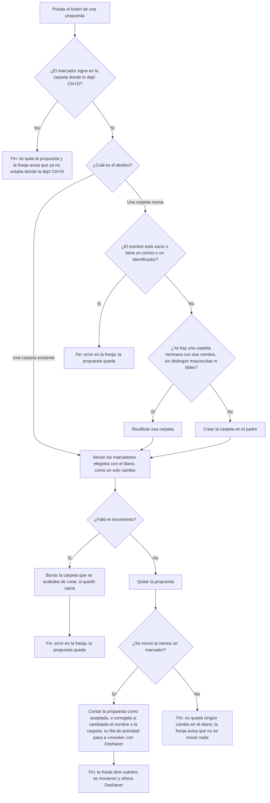

«Aceptar las N de X» y «Aceptar todas» preparan cada grupo (reutilizan o crean sus carpetas) y hacen **un único movimiento**: un solo cambio del diario, que un Deshacer revierte entero, carpetas creadas incluidas. Si falla, borran las carpetas recién creadas y las propuestas quedan. «Dejar como está» quita la propuesta, cuenta una descartada y pasa su fila a `left` con el motivo `discarded`.

### Flujo de Deshacer

Es lo que hace el botón «Deshacer» de la franja o de una fila de la actividad. Es por **cambio**: devuelve exactamente lo que ese cambio movió.

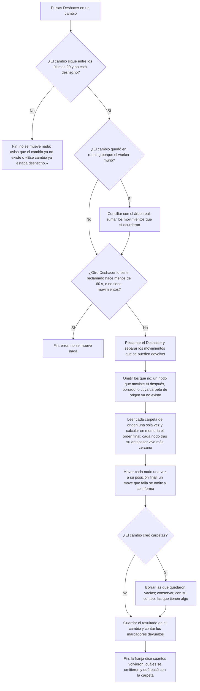

Un cambio que se deshizo no se puede deshacer otra vez: la acción ya no se ofrece, y si se pide igual, avisa «Ese cambio ya estaba deshecho.». Deshacer **no restaura** lo que se hizo fuera de la extensión ni un reorden hecho desde otro dispositivo.

### Flujo de «Ordenar sueltos»

Es un botón: nunca corre solo. La confirmación se calcula sin enviar nada, y todo resultado es una propuesta, también en modo automático.

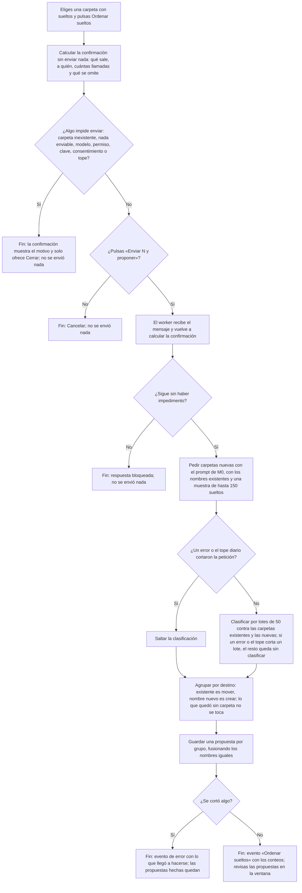

Un nombre nuevo se crea **dentro de la carpeta que ordenas**, o dentro de su padre existente si el nombre tiene la forma «Padre/Hijo». Las propuestas se aceptan con el [flujo de aceptar](#flujo-de-aceptar-una-propuesta); cada marcador del grupo se puede desmarcar, incluido el primero.

## Estados de la extensión

### Estado de la extensión

Lo calcula `getStatus` cada vez que se abre la ventana o cambia algo; no es un valor guardado, sino una función de los ajustes y del entorno. Cualquier cambio de ajuste, permiso, clave, consentimiento o día lo reevalúa. Los problemas se miran **en este orden** y manda el primero que se cumpla.

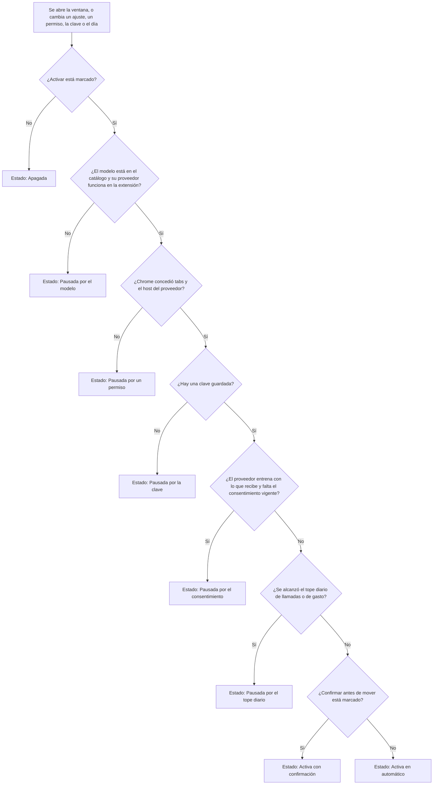

| Estado | Qué hace Ctrl+D | Qué ves | Cómo salir |
|---|---|---|---|
| Apagada | Nada. Es el estado inicial | «Orden automático apagado» y el botón «Activar» | Marcar «Activar» y guardar en los ajustes |
| Activa con confirmación | Cada respuesta de la IA es una propuesta | «Orden con confirmación · modelo · N/máx hoy» | Es el estado normal |
| Activa en automático | Mueve cuando la IA dice `existing` con confianza alta; el resto son propuestas | «Orden automático activo · modelo · N/máx hoy» | Marcar «Confirmar antes de mover» |
| Pausada: modelo | Deja cada marcador con `unknown-model` o `provider-pending` | «Pausada: el modelo elegido no está en el catálogo», o «…ese proveedor aún no funciona en la extensión», con «Ajustes» | Elegir otro modelo. Anthropic aparece como «próximamente» |
| Pausada: permiso | Deja el marcador con `no-permission` y marca la insignia | «Pausada: falta un permiso de Chrome» con «Reparar» | Pulsar «Reparar» y conceder `tabs` y el host del proveedor |
| Pausada: clave | Deja el marcador con `no-key` y marca la insignia | «Pausada: no hay una clave guardada para este proveedor. Agrégala en Ajustes.» con «Ajustes» | Pegar la clave |
| Pausada: consentimiento | Deja el marcador con `no-consent` | «Pausada: falta aceptar la política de datos en Ajustes» con «Ajustes» | Marcar el consentimiento en los ajustes |
| Pausada: tope diario | Deja el marcador con `daily-calls` o `daily-budget` y marca la insignia | «Pausada: se alcanzó el tope diario. Vuelve a intentarlo mañana o súbelo en Ajustes.» | Esperar al día siguiente (hora local) o subir el tope de llamadas. El de US$0,10 es fijo |

Un aviso de **carpeta excluida que cambió** no pausa nada: la línea de estado lo agrega. «Pausada» es un estado de la configuración, no de un error: una llamada que falla (clave inválida, cuota) no pausa la extensión, queda como un evento `error` en la actividad y marca la insignia.

### Estado de una propuesta

Una propuesta vive en el almacenamiento hasta que se aplica, se descarta o desaparece por una de las causas de abajo.

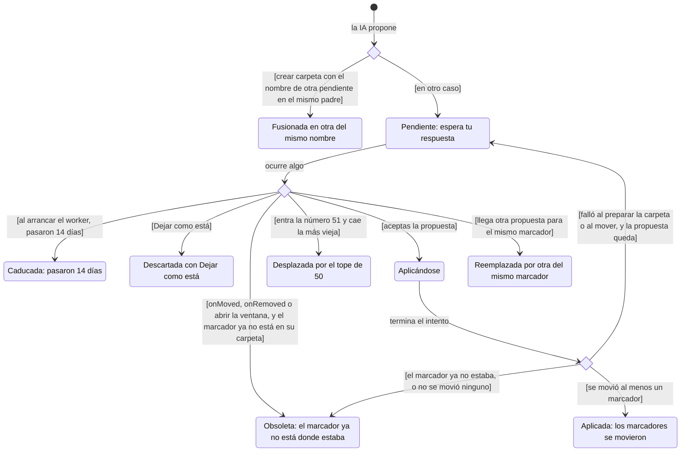

Cada salida que quita una propuesta deja rastro. Las que caducan o caen por el tope se registran como `expired` y cuentan en la métrica «caducadas». Una descartada pasa su fila de actividad a `left` con `discarded`. Una aplicada, a `moved` con su Deshacer. Una obsoleta no se registra aparte.

## Flujos de la evaluación (M0)

### Flujo de la evaluación

Es el comando `run`. El detalle de cada modelo está en el [flujo de un modelo](#flujo-de-un-modelo); el de una señal, en el [flujo de una señal](#flujo-de-una-señal), y el recorrido de la persona, en [Navegación](#navegación).

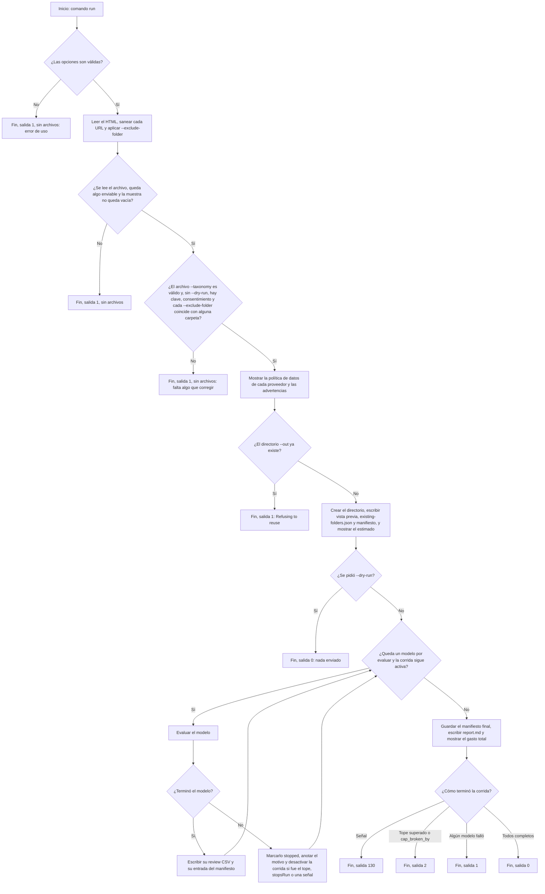

Un modelo que falla no detiene a los siguientes. Lo detiene todo el tope de gasto, `cap_broken_by`, un error con `stopsRun` y una señal. La salida sigue la prioridad del rombo final: señal, tope, fallo, éxito. Con todos los modelos completos puede haber salida 2 si el gasto cruzó el tope en la última llamada.

### Flujo de un modelo

Es el paso «Evaluar el modelo». El bucle de lotes escribe en disco antes de seguir; por eso un modelo detenido deja lo pagado en `assignments-*.jsonl` y `taxonomy-*.json`, aunque no deje CSV de revisión.

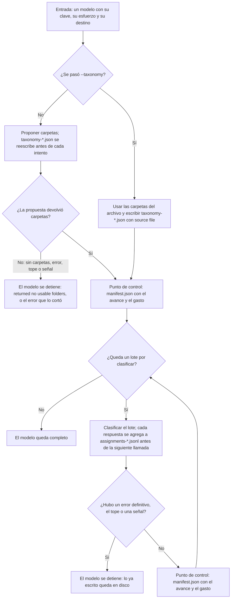

### Flujo de la propuesta de carpetas

Detalla el paso «Proponer carpetas». Una negativa o un truncado no hacen fallar la colección: el modelo recibe una muestra que crece por partes y solo se descartan las partes pequeñas que siguen rechazadas. El resultado dice de cuántos marcadores salió la taxonomía (`built_from`). El techo es de unas 15 llamadas para 150 marcadores.

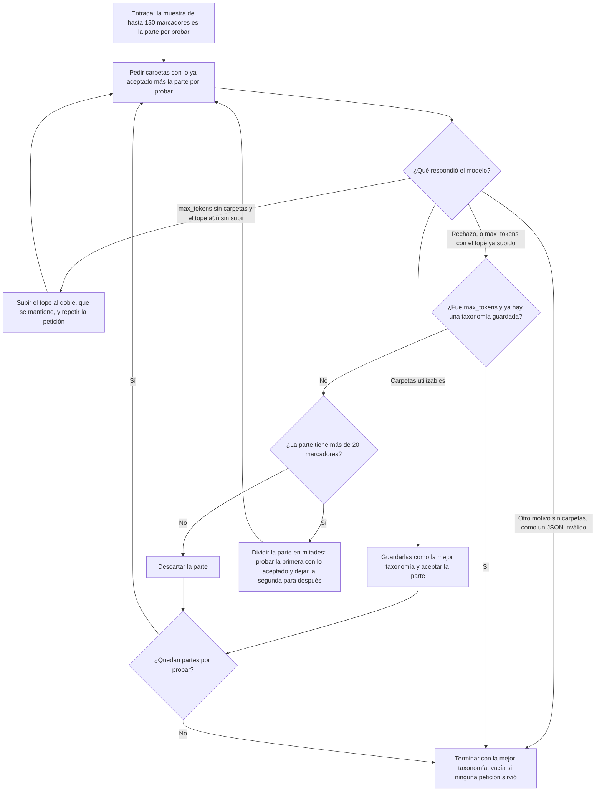

La segunda mitad se prueba entera, salvo que la primera se haya aceptado entera: entonces se divide de inmediato, porque probarla completa repetiría la petición que acaba de fallar. Si el resultado final es una lista vacía, `run` detiene el modelo con `returned no usable folders (stop reason: ...)`. Las carpetas se normalizan: se descartan, con su motivo (`empty`, `reserved`, `too_deep`, `too_long`, `duplicate`, `over_limit`), los nombres vacíos, `__unsorted__` y `(unclassified)`, de más de 60 caracteres, de más de 2 niveles o repetidos sin distinguir mayúsculas.

### Flujo de clasificación de un lote

Una **porción** es un lote completo, una mitad o un grupo de faltantes. Las mitades conservan el contador de reintentos de su porción de origen.

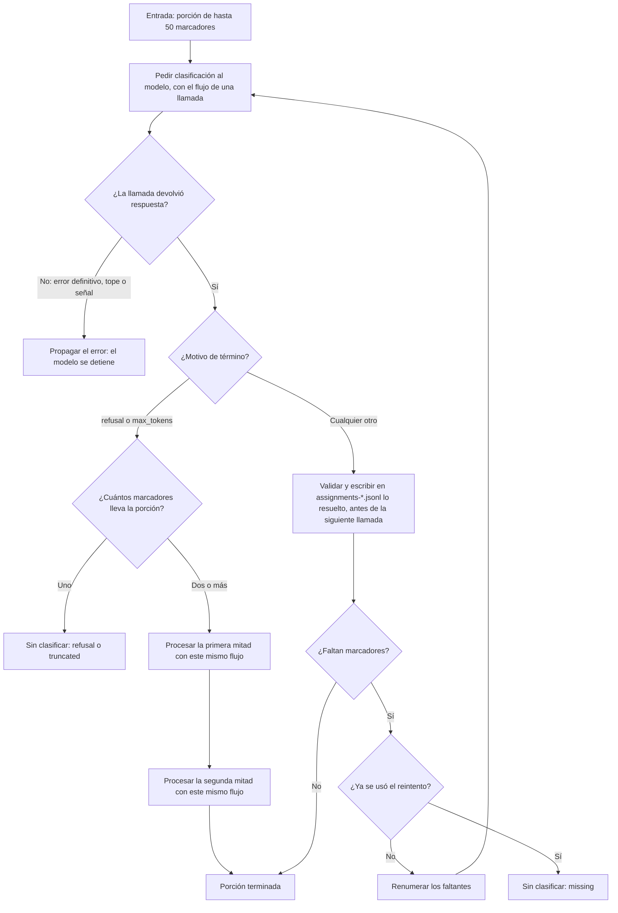

Un marcador **falta** si no tiene exactamente una entrada válida:

- **Ninguna:** su índice no viene, o viene con una carpeta inexistente o una confianza desconocida.
- **Varias:** dos o más entradas válidas repiten su índice. Se descartan todas, porque no se puede saber cuál era la buena.

Una entrada inválida junto a una válida no anula a esta: la válida se acepta. Un `refusal` o `max_tokens` de una porción de dos o más solo la divide: no escribe nada hasta que cada mitad se resuelve.

### Flujo de una llamada a la API

Toda petición pasa por este control, tanto al proponer carpetas como al clasificar. Se repite completo en cada intento, porque el control del tope va **dentro** del bucle de reintentos.

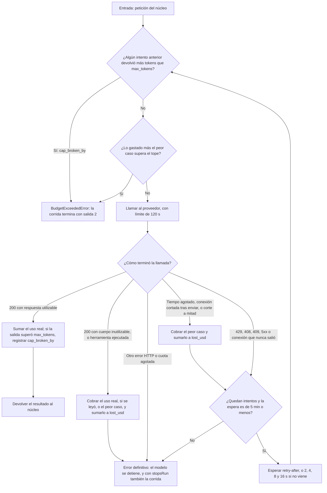

- Son 5 intentos como máximo, y 2 si hubo un tiempo agotado: una llamada que expiró pudo facturarse completa. La decisión de rendirse ocurre **antes** de esperar: con `retry-after: 3600` termina de inmediato.
- **Cobro al peor caso.** Si una llamada pudo facturarse sin devolver uso (tiempo agotado, conexión cortada tras enviar, un 200 ilegible sin uso), se carga a `spent_usd` el costo del peor caso y también a `lost_usd`. El tope sigue siendo un techo a costa de un total pesimista. Una respuesta HTTP que no es 2xx no se cobra.
- **Guardia de `max_tokens`.** El peor caso supone que el proveedor respeta `max_tokens`. Si una respuesta trae más tokens de salida, se entrega esa respuesta ya pagada, se registra `cap_broken_by` y la llamada siguiente falla. El exceso queda limitado a una llamada. Detalle y proveedores con duda: [Proveedores](proveedores.md#tope-de-gasto-y-max_tokens).
- 429 con `enforced_spend_limit_reached` (límite de gasto propio de Anthropic) y los 429 de cuota agotada de OpenAI no se reintentan.
- En Opus, Sonnet y Fable, y solo con `--fallback`, Anthropic puede reintentar una negativa en otro modelo dentro de la misma llamada; el costo del intento adicional se cobra a su propia tarifa. Para este flujo sigue siendo una sola respuesta.

### Flujo de una señal

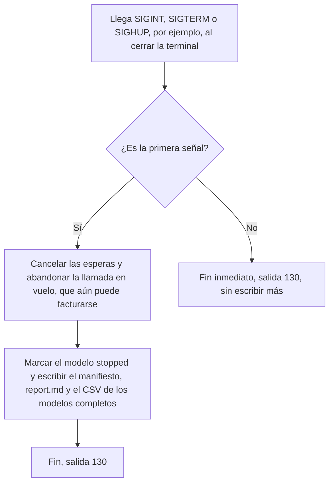

El manifiesto queda `stopped` con el motivo `interrupted by SIGINT; a call in flight may still be billed` (o la señal que llegó), y `Total spent` lo repite. Es posible que el gasto real sea mayor que el informado.

### Flujo de blind

Es el comando `blind`, con `--previous` opcional. La lista se arma sobre pares marcador-carpeta, no sobre filas de un brazo.

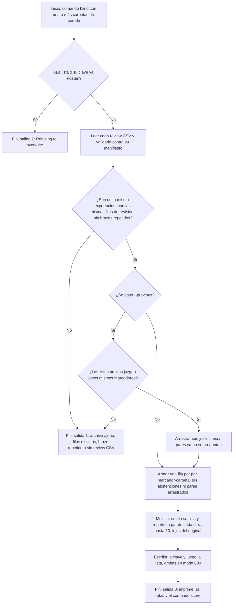

### Flujo de puntaje

Es el comando `score`. Con un solo archivo que tiene su `.key.json` al lado lee una lista ciega; con uno o varios `review-*.csv`, los compara.

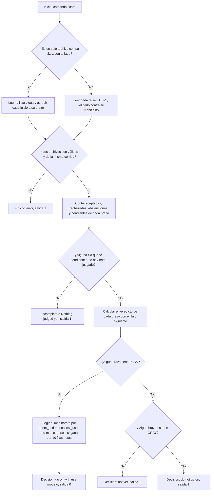

Un valor no reconocido en `judgment` cuenta como pendiente. Una `y` en una fila `__unsorted__` o `(unclassified)` se ignora y se avisa: esas filas no se juzgan.

### Veredicto de un brazo

Reglas de `score`, en el orden en que deciden. Se evalúan las más fuertes primero; el programa imprime **todos** los motivos que aplican, no solo el que decide.

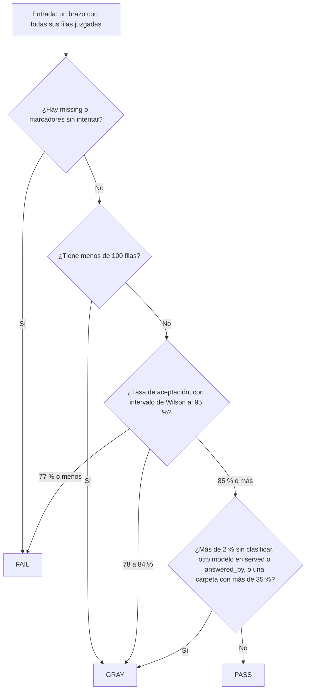

La tasa es aceptadas sobre todas las filas del brazo, con las abstenciones como no aceptadas.

## Estados de la evaluación (M0)

### Estado de una corrida

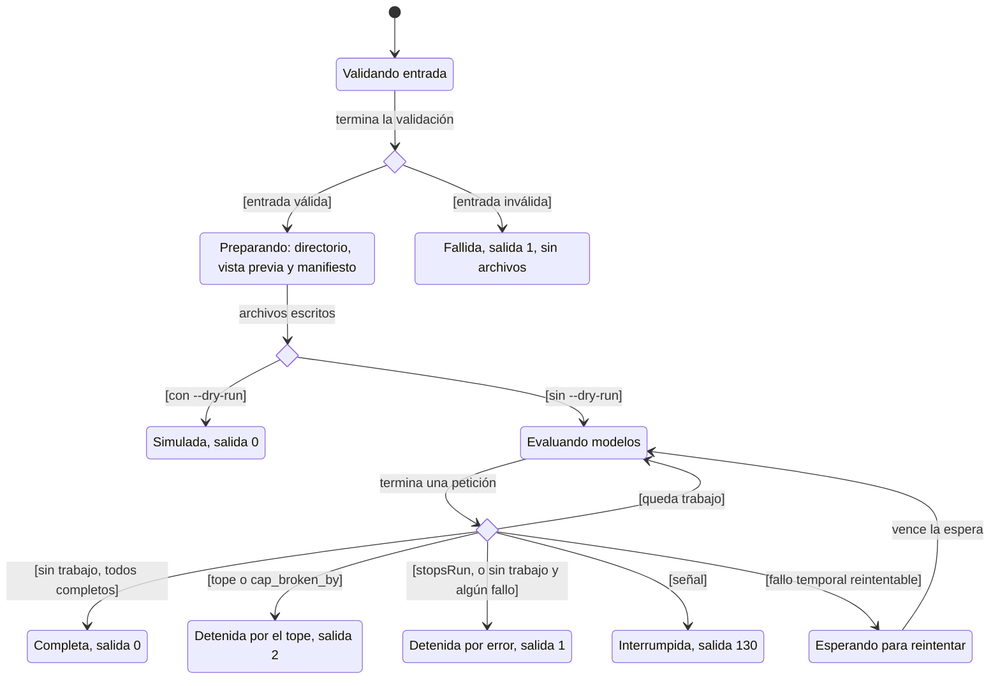

| Condición | Qué cubre |
|---|---|
| Entrada inválida | Opción desconocida, sin valor o fuera de rango; falta `--input`; `--models` ausente sin `--dry-run`; modelo sin precio; archivo ilegible o sin ningún marcador enviable; `--taxonomy` inválido; clave faltante o con forma inválida; consentimiento de datos pendiente; un `--exclude-folder` sin coincidencias (solo avisa con `--dry-run`); `--out` ya existente |
| Fallo temporal reintentable | 429, 408, 409, 5xx, fallo de conexión o tiempo agotado, con intentos disponibles y espera de hasta 5 min |
| Queda trabajo | Quedan lotes del modelo o modelos por evaluar |
| Tope superado o `cap_broken_by` | El tope rechazó una petición, el gasto lo cruzó o un proveedor devolvió más tokens que `max_tokens`. Puede ocurrir con todos los modelos completos |
| `stopsRun` | Un error que detiene toda la corrida, hoy el de Perplexity cuando una herramienta corrió con el contenido |

Si varias condiciones se cumplen a la vez, el orden de prioridad de la salida es: señal, tope, error. Todas las salidas distintas de «Fallida» y «Simulada» escriben `manifest.json` y `report.md`, y un CSV por cada modelo completo. Una corrida detenida puede no tener ningún modelo completo: sin clave ni crédito, termina con el reporte, US$0 gastados y el motivo `Stopped early`. Los estados finales no tienen salida: no hay reanudación.

### Estado de un marcador

Dentro del recuadro «Procesamiento con cada modelo», el marcador tiene un estado independiente **por cada modelo**.

«Sin procesar: el modelo se detuvo» ocurre cuando el modelo se detiene (error definitivo, tope, señal o sin carpetas) con el marcador aún sin resolver. Los marcadores que ya tenían resultado lo **conservan** en `assignments-*.jsonl`; el modelo no deja CSV de revisión. Los modelos siguientes no se ejecutan solo si la corrida se detuvo por el tope, por `stopsRun` o por una señal.

Hasta 150 marcadores de la muestra viajan en la propuesta de carpetas, antes de la primera petición de clasificación.

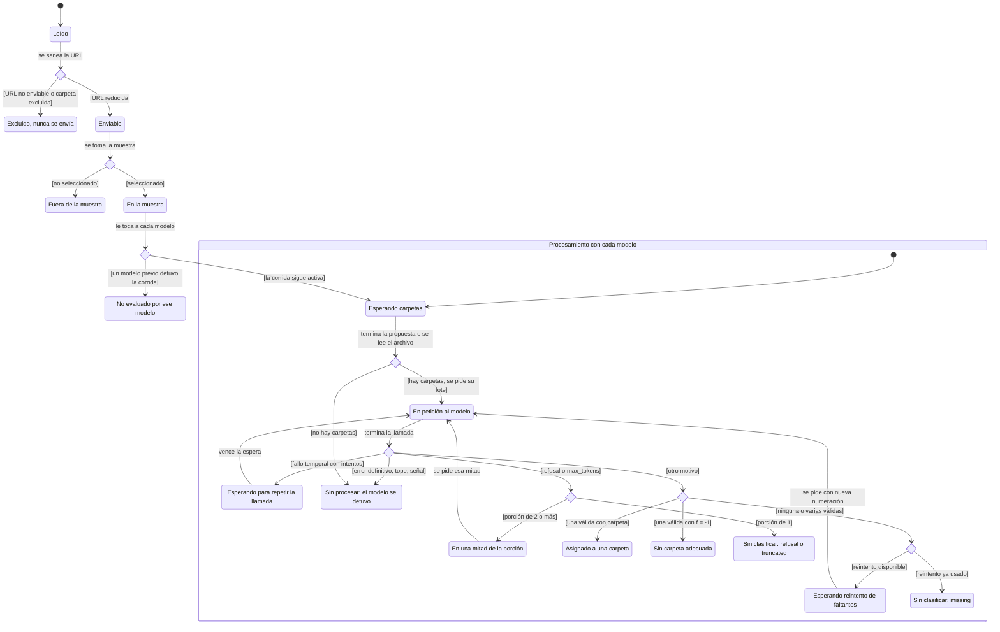

`f` es el número de carpeta que responde el modelo; `-1` significa que ninguna sirve.

| Estado final | Dónde se ve | Valor en el CSV de revisión |
|---|---|---|
| Excluido | Conteo «Never sent» y su motivo | No aparece |
| Fuera de la muestra | No se reporta por marcador | No aparece |
| Asignado a una carpeta | `assigned_folder`, `confidence` y `served_model` en `assignments-*.jsonl` | Nombre de la carpeta |
| Sin carpeta adecuada | `assigned_folder` | `__unsorted__` |
| Sin clasificar, por cualquiera de sus motivos | `unclassified` y `refusal_category` en `assignments-*.jsonl`; el motivo en `report.md` | `(unclassified)` |
| Sin procesar: el modelo se detuvo | Cuenta como `not attempted` en `M0 completeness`; la sección del modelo en `report.md` dice `INCOMPLETE` | No hay CSV de ese modelo |
| No evaluado por ese modelo | No hay sección en `report.md` ni CSV de ese modelo | No aparece |

Solo una parte de la muestra llega al CSV: 100 marcadores por defecto.

## Navegación

### Recorrido con la extensión

Es el recorrido de la primera vez, con sus desvíos. Los pasos con sus comandos están en el [Quick start](quick-start.md#usar-la-extensión).

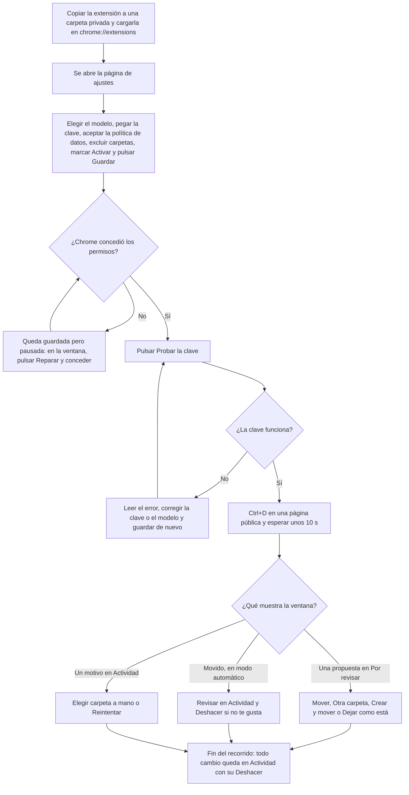

### Qué hay en la ventana y en los ajustes

La **ventana** es el popup del ícono (también se abre en una pestaña con «Abrir en pestaña»). De arriba abajo:

| Parte | Qué muestra |
|---|---|
| Línea de estado | El [estado](#estado-de-la-extensión) con el modelo y las llamadas del día; «Activar», «Reparar» o «Ajustes» según el caso |
| Franja de resultado | Lo que pasó con la última acción, con «Deshacer» mientras se pueda, y «Cerrar». Sobrevive a cerrar la ventana |
| Por revisar | Las propuestas pendientes, agrupadas cuando varias crean la misma carpeta, con «Aceptar las N de X» |
| Ordenar sueltos | Un selector con las carpetas que tienen sueltos y el botón «Ordenar sueltos» |
| Actividad reciente | Los últimos eventos, con «Deshacer», «Elegir carpeta», «Reintentar» o «Quitar el duplicado nuevo» según la fila. «Ver más» |
| Línea semanal | Los marcadores ubicados esta semana, y los sueltos de la barra |
| Respaldo | «Respaldar ahora» y cuándo fue el último |

La **página de ajustes** se abre sola al instalar y con «Ajustes ↗»: el orden automático (activar, confirmar, modelo, clave, política y consentimiento, contexto, carpetas excluidas, tope diario, uso del día y «Ver qué se envió»), «Ordenar sueltos» y una tabla de marcadores por raíz.

### Línea de comandos (evaluación)

La evaluación no tiene pantallas. Este es el recorrido de la persona, por comandos y archivos, hasta la decisión de M0. La sintaxis de cada comando y los tiempos estimados están en el [Quick start](quick-start.md).

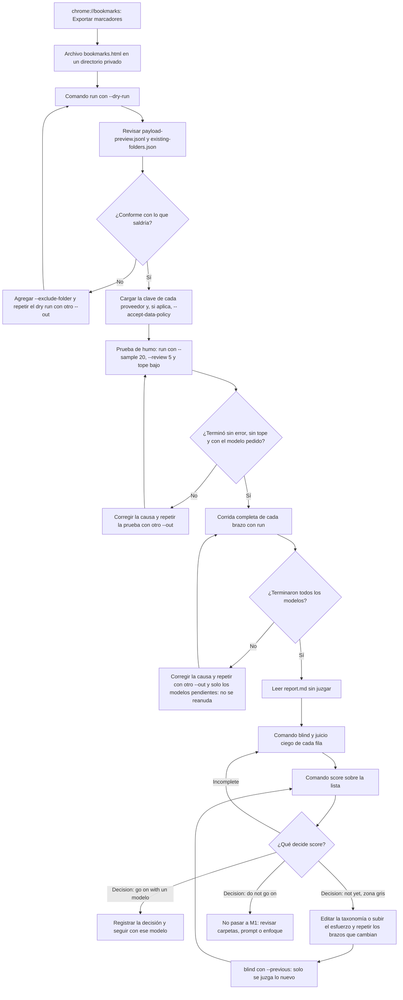

«Sin faltantes» se lee en `report.md` (`M0 completeness`) y también lo comprueba `score`: un `missing` fuerza `FAIL`.
